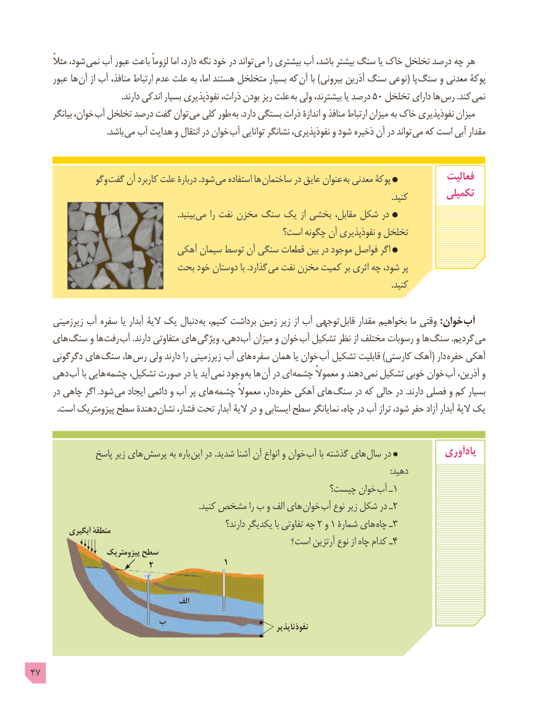

# PDF page 47

ًشود،مثال        نمی آب عبور باعث لزوماً اما دارد، نگه خود در تواند  می را بیشتری آب باشد، بیشتر سنگ یا خاک تخلخل درصد چه هر
      عبور ها  آن از آب منافذ، ارتباط عدم علت به اما، هستند متخلخل بسیار که آن با )بیرونی آذرین سنگ نوعی( پا سنگ و معدنی پوکۀ
                                           .دارند اندکی بسیار نفوذپذیری ذرات، بودن ریز علت به ولی بیشترند، یا درصد 50 تخلخل دارای ها رس .کند  نمی
       بیانگر خوان،  آب تخلخل درصد گفت توان می کلی طور به .دارد بستگی ذرات اندازۀ و منافذ ارتباط میزان به خاک نفوذپذیری میزان
        . باشد می آب هدایت و انتقال در خوان آب توانایی نشانگر نفوذپذیری، و شود ذخیره آن در تواند می که است آبی مقدار

                وگو گفت آن کاربرد علت دربارۀ .شود می استفاده ها ساختمان در عایق عنوان به معدنی پوکۀ            فعالیت
                                                                                                                                                                            .کنید        تکمیلی
                                                                      .بینید  می را نفت مخزن سنگ یک از بخشی مقابل، شکل در
                                                   است؟ چگونه آن نفوذپذیری و تخلخل
                              آهکی سیمان توسط آن سنگی قطعات بین در موجود فواصل اگر
                          بحث خود دوستان با .گذارد می نفت مخزن کمیت بر اثری چه شود، پر
                                                                                                                                                                            .کنید

      زیرزمینی آب سفره یا آبدار الیۀ یک دنبال  به کنیم، برداشت زمین زیر از آب توجهی قابل مقدار بخواهیم ما وقتی :خوان آب
    های سنگ و ها  رفت آب .دارند متفاوتی های  ویژگی دهی، آب میزان و خوان آب تشکیل نظر از مختلف رسوبات و ها سنگ .گردیم  می
     دگرگونی های سنگ ها، رس ولی دارند را زیرزمینی آب های سفره همان یا خوان آب تشکیل قابلیت )کارستی آهک( دار حفره آهکی
    دهی آب با هایی چشمه تشکیل، صورت در یا آید  نمی وجود به ها آن در ای چشمه معموالً و دهند نمی تشکیل خوبی خوان آب آذرین، و
      در چاهی اگر .شود می ایجاد دائمی و آب پر های چشمه معموالً دار، حفره آهکی های سنگ در که حالی در .دارند فصلی و کم بسیار
 . است پیزومتریک سطح دهندۀ نشان فشار، تحت آبدار الیۀ در و ایستابی سطح نمایانگر چاه، در آب تراز شود، حفر آزاد آبدار الیۀ یک

               پاسخ زیر های پرسش به باره  این در .شدید آشنا آن انواع و خوان آب با گذشته های سال در            یادآوری
                                                                                                                                                                           :دهید
                                                        چیست؟ خوان آب ـ1
                                                                                .کنید مشخص را ب و الف های خوان آب نوع زیر شکل در ـ2
                                                           دارند؟ یکدیگر با تفاوتی چه 2 و 1 شمارۀ های 3چاه ـ          آبگیری منطقۀ
                                                      است؟ آرتزین نوع از چاه کدام ـ4
                    پیزومتریک سطح
                                       1                        2

                                         الف
                  ب                                                                                ناپذیر  نفوذ

47

