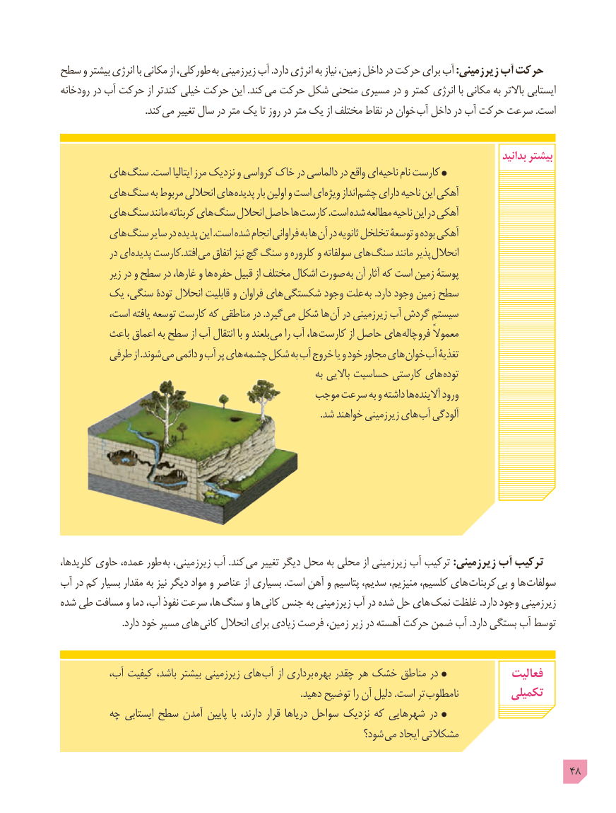

# PDF page 48

سطح و بیشتر انرژی با مکانی از طورکلی، به زیرزمینی آب .دارد انرژی به نیاز زمین، داخل در حرکت برای آب :زیرزمینی آب حرکت
رودخانه در آب حرکت از کندتر خیلی حرکت این .کند می حرکت شکل منحنی مسیری در و کمتر انرژی با مکانی به باالتر ایستابی
         . کند می تغییر سال در متر یک تا روز در متر یک از مختلف نقاط در خوان آب داخل در آب حرکت سرعت .است

                                                                                                              بدانید بیشتر
        های سنگ .است ایتالیا مرز نزدیک و کرواسی خاک در دالماسی در واقع ای ناحیه نام کارست
        های سنگ به مربوط انحاللی های پدیده بار اولین و است ای ویژه انداز چشم دارای ناحیه این آهکی
        های سنگ مانند کربناته های سنگ انحالل حاصل ها کارست .است شده مطالعه ناحیه این در آهکی
        های سنگ سایر در پدیده این .است شده انجام فراوانی به ها آن در ثانویه تخلخل توسعۀ و بوده آهکی
            در ای پدیده کارست.افتد می اتفاق نیز گچ سنگ و کلروره و سولفاته های سنگ مانند پذیر انحالل
             زیر در و سطح در غارها، و ها حفره قبیل از مختلف اشکال صورت به آن آثار که است زمین پوستۀ
       یک سنگی، تودۀ انحالل قابلیت و فراوان های شکستگی وجود علت به .دارد وجود زمین سطح
          است، یافته توسعه کارست که مناطقی در .گیرد می شکل ها آن در زیرزمینی آب گردش سیستم
          باعث اعماق به سطح از آب انتقال با و بلعند می را آب ها، کارست از حاصل های فروچاله معموالً
         طرفی از .شوند می دائمی و آب پر های چشمه شکل به آب خروج یا و خود مجاور های خوان آب تغذیۀ
                                                                  به باالیی حساسیت کارستی های توده
                                         موجب سرعت به و داشته ها آالینده ورود
     . شد خواهند زیرزمینی های آب آلودگی

کلریدها، حاوی عمده، طور به زیرزمینی، آب .کند می تغییر دیگر محل به محلی از زیرزمینی آب ترکیب :زیرزمینی آب ترکیب
آب در کم بسیار مقدار به نیز دیگر مواد و عناصر از بسیاری .است آهن و پتاسیم سدیم، منیزیم، کلسیم، های کربنات بی و ها سولفات
شده طی مسافت و دما آب، نفوذ سرعت ها، سنگ و ها کانی جنس به زیرزمینی آب در شده حل های نمک غلظت .دارد وجود زیرزمینی
  . دارد خود مسیر های کانی انحالل برای زیادی فرصت زمین، زیر در آهسته حرکت ضمن آب .دارد بستگی آب توسط

 ،هایآب کیفیت باشد، بیشتر زیرزمینی        آب از برداری بهره چقدر هر خشک مناطق در              فعالیت
                                                                                                    .دهید توضیح را آن دلیل .است تر نامطلوب          تکمیلی
         چه ایستابی سطح آمدن پایین  با دارند، قرار دریاها سواحل نزدیک که شهرهایی در
                                                            شود؟ می ایجاد مشکالتی

                                                                                             48

