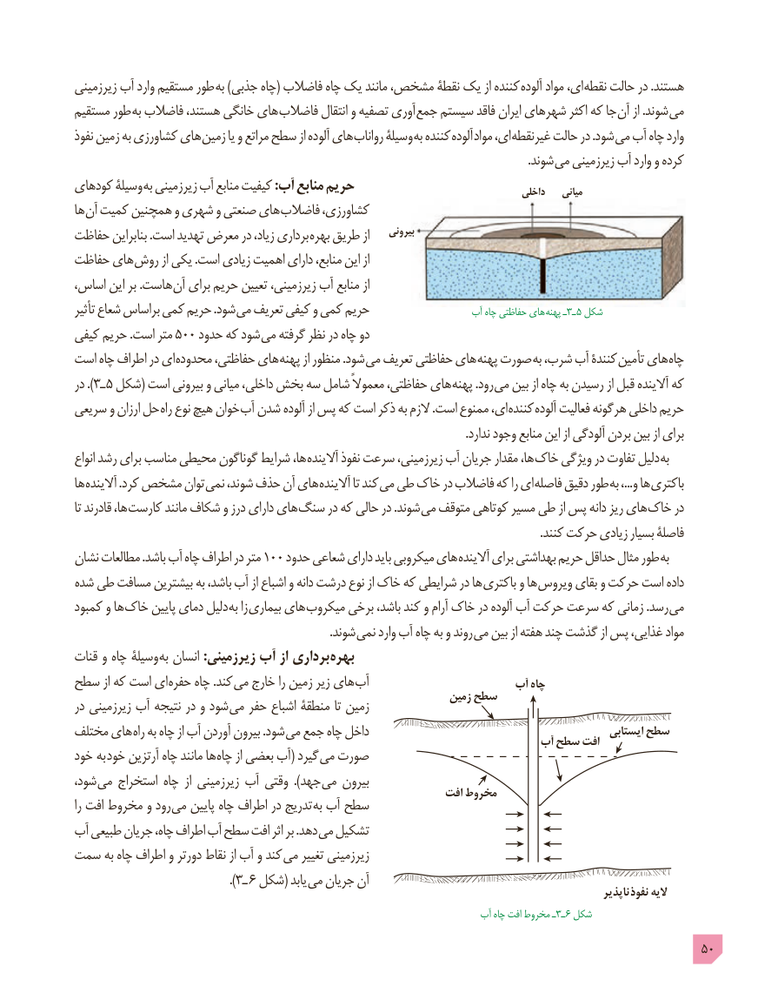

# PDF page 50

زیرزمینی آب وارد مستقیم طور به )جذبی چاه( فاضالب چاه یک مانند مشخص، نقطۀ یک از کننده آلوده مواد ای، نقطه حالت در .هستند
مستقیم طور به فاضالب هستند، خانگی های فاضالب انتقال و تصفیه آوری جمع سیستم فاقد ایران شهرهای اکثر که جا آن از .شوند می
نفوذ زمین به کشاورزی های زمین یا و مراتع سطح از آلوده های رواناب وسیلۀ به کننده آلوده مواد ای، غیرنقطه حالت در .شود می آب چاه وارد
                                                                                                                                                         .شوند می زیرزمینی آب وارد و کرده
کودهای وسیلۀ به زیرزمینی آب منابع کیفیت :آب منابع حریم                                    داخلی    میانی
ها آن کمیت همچنین و شهری و صنعتی های فاضالب کشاورزی،
حفاظت بنابراین .است تهدید معرض در زیاد، برداری بهره طریق از    بیرونی
حفاظت های روش از یکی .است زیادی اهمیت دارای منابع، این از
اساس، این بر .هاست آن برای حریم تعیین زیرزمینی، آب منابع از
تأثیر شعاع براساس کمی حریم .شود می تعریف کیفی و کمی حریم                   آب چاه حفاظتی های  پهنه ـ٣ـ ٥ شکل
کیفی حریم .است متر 500 حدود که شود می گرفته نظر در چاه دو
است چاه اطراف در ای محدوده حفاظتی، های پهنه از منظور .شود می تعریف حفاظتی های پهنه صورت به شرب، آب کنندۀ تأمین های چاه
در ).ـ٣ ٥ شکل( است بیرونی و میانی داخلی، بخش سه شامل معموالً حفاظتی، های پهنه .رود می بین از چاه به رسیدن از قبل آالینده که
سریعی و ارزان حل راه نوع هیچ خوان آب شدن آلوده از پس که است ذکر به الزم .است ممنوع ای، کننده آلوده فعالیت هرگونه داخلی حریم
                                                                                                                                    .ندارد وجود منابع این از آلودگی بردن بین از برای
انواع رشد برای مناسب محیطی گوناگون شرایط ها، آالینده نفوذ سرعت زیرزمینی، آب جریان مقدار ها، خاک ویژگی در تفاوت دلیل به
ها آالینده .کرد مشخص توان نمی شوند، حذف آن های آالینده تا کند می طی خاک در فاضالب که را ای فاصله دقیق طور به ،...و ها باکتری
تا قادرند ها، کارست مانند شکاف و درز دارای های سنگ در که حالی در .شوند می متوقف کوتاهی مسیر طی از پس دانه ریز های خاک در
                                                                                                                                                             .کنند حرکت زیادی بسیار فاصلۀ
نشان مطالعات .باشد آب چاه اطراف در متر ١٠٠ حدود شعاعی دارای باید میکروبی های آالینده برای بهداشتی حریم حداقل مثال طور به
شده طی مسافت بیشترین به باشد، آب از اشباع و دانه درشت نوع از خاک که شرایطی در ها باکتری و ها ویروس بقای و حرکت است داده
کمبود و ها خاک پایین دمای دلیل به زا بیماری های میکروب برخی باشد، کند و آرام خاک در آلوده آب حرکت سرعت که زمانی .رسد می
                 . شوند نمی وارد آب چاه به و روند می بین از هفته چند گذشت از پس غذایی، مواد
قنات و چاه وسیلۀ به انسان :زیرزمینی آب از برداری بهره
سطح از که است ای حفره چاه .کند می خارج را زمین زیر های آب                      آب چاه
در زیرزمینی آب نتیجه در و شود می حفر اشباع منطقۀ تا زمین               زمین سطح
مختلف های راه به چاه از آب آوردن بیرون .شود می جمع چاه داخل                                                 ایستابی سطح                                                                       آب سطح افت
خود به خود آرتزین چاه مانند ها چاه از بعضی آب( گیرد می صورت
شود، می استخراج چاه  از زیرزمینی آب وقتی  ).جهد می بیرون                                                               افت مخروطرا افت مخروط و رود می پایین چاه اطراف در تدریج به آب سطح
آب طبیعی جریان چاه، اطراف آب سطح افت اثر بر .دهد می تشکیل
سمت به چاه اطراف و دورتر نقاط از آب و کند می تغییر زیرزمینی
                                              ). ـ٣ 6 شکل( یابد می جریان آن                                                                                                                          ناپذیر  نفوذ الیه
                                                                           آب چاه افت مخروط ـ٣ـ 6 شکل
                                                                                            50

