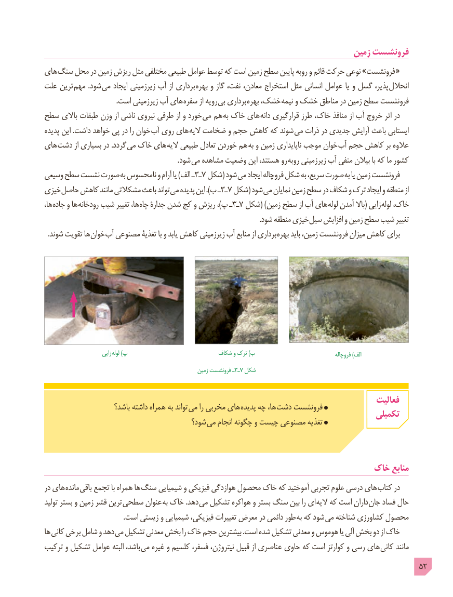

# PDF page 52

زمین فرونشست
های سنگ محل در زمین ریزش مثل مختلفی طبیعی عوامل توسط که است زمین سطح پایین روبه و قائم حرکت نوعی »فرونشست «
علت ترین  مهم .شود می ایجاد زیرزمینی آب از برداری  بهره و گاز نفت، معادن، استخراج مثل انسانی عوامل یا و گسل پذیر،  انحالل
                                         .است زیرزمینی آب های سفره از رویه  بی برداری  بهره خشک،  نیمه و خشک مناطق در زمین سطح فرونشست
سطح باالی طبقات وزن از ناشی نیروی طرفی از و خورد می هم به خاک های دانه قرارگیری طرز خاک، منافذ از آب خروج اثر در
پدیده این .داشت خواهد پی در را خوان آب روی های  الیه ضخامت و حجم کاهش که شوند  می ذرات در جدیدی آرایش باعث ایستابی
های دشت از بسیاری در .گردد  می خاک های  الیه طبیعی تعادل خوردن هم  به و زمین ناپایداری موجب خوان آب حجم کاهش بر عالوه
                                                                             .شود می مشاهده وضعیت این هستند، رو روبه زیرزمینی آب منفی بیالن با که ما کشور
وسیعی سطح نشست صورت به نامحسوس و آرام یا )الف ـ٧3ـ   شکل( شود می ایجاد فروچاله شکل به سریع، صورت به یا زمین فرونشست
خیزی حاصل کاهش مانند مشکالتی باعث تواند می پدیده این ).ب ـ٧3ـ    شکل( شود می نمایان زمین سطح در شکاف و ترک ایجاد و منطقه از
ها، جاده و ها رودخانه شیب تغییر ها، چاه٧جدارۀ شدن کج و ریزش ،)پ ـ٣ـ   شکل( )زمین سطح از آب های لوله آمدن باال( زایی لوله خاک،
        . شود منطقه خیزی سیل افزایش و زمین سطح شیب تغییر
. شوند تقویت ها خوان آب مصنوعی تغذیۀ با و یابد کاهش زیرزمینی آب منابع از برداری بهره باید زمین، فرونشست میزان کاهش برای

                         زایی لوله )پ                           شکاف و ترک )ب                                   فروچاله )الف
                 زمین٧فرونشست ـ٣ـ شکل

                                                                                      فعالیت                      باشد؟ داشته همراه به تواند می را مخربی های پدیده چه ها، دشت فرونشست                                                                                  تکمیلی                                        شود؟ می انجام چگونه و چیست مصنوعی تغذیه

                                                              خاک منابع
در های مانده باقی تجمع با همراه ها سنگ شیمیایی و فیزیکی هوازدگی محصول خاک که آموختید تجربی علوم درسی های کتاب در
تولید بستر و زمین قشر ترین  سطحی عنوان به خاک .دهد می تشکیل هواکره و بستر سنگ بین را ای الیه که است داران  جان فساد حال
 . است زیستی و شیمیایی فیزیکی، تغییرات معرض در دائمی طور به که شود  می شناخته کشاورزی محصول
ها کانی برخی شامل و دهد می تشکیل معدنی بخش را خاک حجم بیشترین .است شده تشکیل معدنی و هوموس یا آلی بخش دو از خاک
ترکیب و تشکیل عوامل البته باشد، می غیره و کلسیم فسفر، نیتروژن، قبیل از عناصری حاوی که است کوارتز و رسی های  کانی مانند
                                                                                            52

