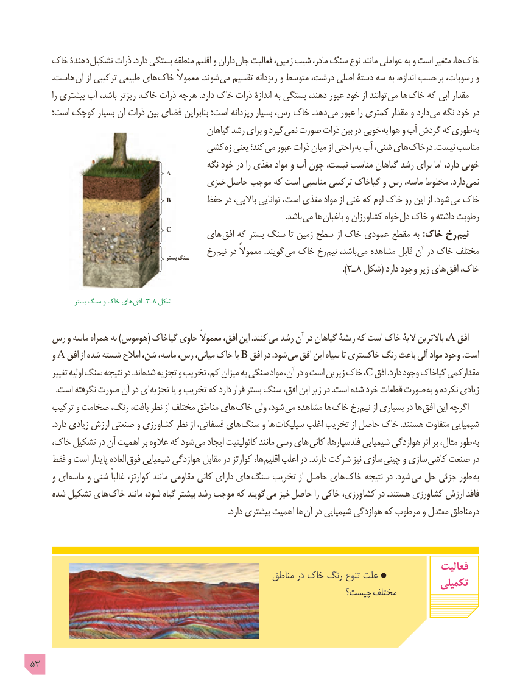

# PDF page 53

خاک دهندۀ تشکیل ذرات .دارد بستگی منطقه اقلیم و داران  جان فعالیت زمین، شیب مادر، سنگ نوع مانند عواملی به و است متغیر ها، خاک
  . هاست آن از ترکیبی طبیعی های خاک معموالً .شوند می تقسیم ریزدانه و متوسط درشت، اصلی دستۀ سه به اندازه، برحسب رسوبات، و
        را بیشتری آب باشد، ریزتر خاک، ذرات هرچه .دارد خاک ذرات اندازۀ به بستگی دهند، عبور خود از توانند  می ها خاک که آبی مقدار
     است؛ کوچک بسیار آن ذرات بین فضای بنابراین است؛ ریزدانه بسیار رس، خاک .دهد  می عبور را کمتری مقدار و دارد می نگه خود در
                                              گیاهان رشد برای و گیرد نمی صورت ذرات بین در خوبی  به هوا و آب گردش که  طوری به
                              کشی زه یعنی کند؛  می عبور ذرات میان از راحتی به آب شنی، های  درخاک .نیست مناسب
                                             نگه خود در را مغذی مواد و آب چون نیست، مناسب گیاهان رشد برای اما دارد، خوبی
                             A       خیزی حاصل موجب که است مناسبی ترکیبی گیاخاک و رس ماسه، مخلوط .دارد نمی

                                B                                  حفظ در باالیی، توانایی است، مغذی مواد از غنی که لوم خاک رو این از .شود  می خاک
                                                                                                                              .باشد می ها باغبان و کشاورزان خواه دل خاک و داشته رطوبت
                             C                                    های افق که بستر سنگ تا زمین سطح از خاک عمودی مقطع به :خاک رخ نیم
                                       رخ  نیم در معموالً .گویند  می خاک رخ نیم باشد،  می مشاهده قابل آن در خاک مختلف                                                   بستر سنگ
                                                                  ). 8ـ٣ شکل( دارد وجود زیر های افق خاک،

               بستر سنگ و خاک های  افق ـ٣ـ ٨ شکل

   رس و ماسه همراه به )هوموس( گیاخاک حاوی معموالً افق، این .کنند می رشد آن در گیاهان ریشۀ که است خاک الیۀ باالترین ، A افق
      و A افق از شده شسته امالح شن، ماسه، رس، میانی، خاک یا B افق در .شود می افق این سیاه تا خاکستری رنگ باعث آلی مواد وجود .است
       تغییر اولیه سنگ نتیجه در .اند شده تجزیه و تخریب کم، میزان به سنگی مواد آن، در و است زیرین خاک ، C افق .دارد وجود گیاخاک مقدارکمی
 . است نگرفته صورت آن در ای تجزیه یا و تخریب که دارد قرار بستر سنگ افق، این زیر در .است شده خرد قطعات صورت به و نکرده زیادی
     ترکیب و ضخامت رنگ، بافت، نظر از مختلف مناطق های  خاک ولی شود، می مشاهده ها خاک رخ نیم از بسیاری در ها افق این اگرچه
           .دارد زیادی ارزش صنعتی و کشاورزی نظر از فسفاتی، های سنگ و ها  سیلیکات اغلب تخریب از حاصل خاک .هستند متفاوت شیمیایی
     خاک، تشکیل در آن اهمیت بر عالوه که شود می ایجاد کائولینیت مانند رسى هاى کانی فلدسپارها، شیمیایی هوازدگى اثر بر مثال، طور به
     فقط و است پایدار العاده  فوق شیمیایی هوازدگی مقابل در کوارتز ها، اقلیم اغلب در .دارند شرکت نیز سازی چینی و سازی  کاشی صنعت در
      و ای ماسه و شنی غالباً کوارتز، مانند مقاومی کانی دارای های سنگ تخریب از حاصل های خاک نتیجه در .شود می حل جزئی طور به
     شده تشکیل های  خاک مانند شود، گیاه بیشتر رشد موجب که گویند  می خیز حاصل را خاکی کشاورزی، در .هستند کشاورزی ارزش فاقد
     . دارد بیشتری اهمیت ها آن در شیمیایی هوازدگی که مرطوب و معتدل درمناطق

                                                                                           فعالیت                                                       مناطق در خاک رنگ تنوع علت                                                                                       تکمیلی                                                            چیست؟ مختلف

53

