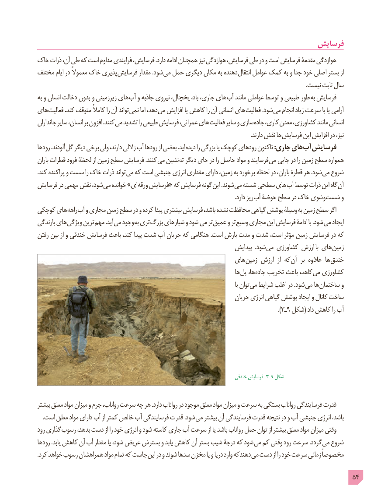

# PDF page 54

فرسایش
خاک ذرات آن، طی که است مداوم فرایندی فرسایش، .دارد ادامه همچنان نیز هوازدگى فرسایش، طى در و است فرسایش مقدمۀ هوازدگى
مختلف ایام در معموالً خاک پذیری فرسایش مقدار .شود می حمل دیگری مکان به دهنده انتقال عوامل کمک به و جدا خود اصلی بستر از
                                                                                                                                                                                        .نیست ثابت سال
به و انسان دخالت بدون و زیرزمینی های آب و جاذبه نیروی یخچال، باد، جاری، های آب مانند عواملی توسط و طبیعی طور به فرسایش
های فعالیت .کند متوقف کامالً را آن تواند نمی اما دهد، می افزایش یا کاهش را آن انسانی های فعالیت .شود می انجام زیاد سرعت با یا آرامی
جانداران سایر انسان، بر افزون .کنند می تشدید را طبیعی فرسایش عمرانی، های فعالیت سایر و سازی جاده کاری، معدن کشاورزی، مانند انسانی
             . دارند نقش ها فرسایش این افزایش در نیز،
رودها .آلودند گل دیگر برخى ولى دارند، زاللى آب رودها از بعضى .اید دیده را بزرگى یا کوچک رودهاى تاکنون :جاری های آب فرسایش
باران قطرات فرود لحظۀ از زمین سطح فرسایش .کنند مى نشین ته دیگر جاى در را حاصل مواد و فرسایند مى جایی در را زمین سطح همواره
.کند پراکنده و سست را خاک ذرات تواند مى که است جنبشى انرژى مقدارى داراى زمین، به برخورد لحظه در باران، قطرۀ هر .شود مى شروع
فرسایش در مهمی نقش شود، مى خوانده »اى ورقه فرسایش« که فرسایش گونه این .شوند مى شسته سطحى هاى آب توسط ذرات این گاه آن
                                                                                                                                        .دارد ریز آب حوضۀ سطح در خاک وشوى شست و
کوچکى هاى راهه آب و مجارى زمین سطح در و کرده پیدا بیشترى فرسایش باشد، نشده محافظت گیاهی پوشش وسیلۀ به زمین سطح اگر
بارندگی های ویژگی ترین مهم .آید مى وجود به ترى بزرگ شیارهای و شود می تر عمیق و تر وسیع مجارى این فرسایش ادامۀ با .شود مى ایجاد
رفتن بین از و خندقی فرسایش باعث کند، پیدا شدت آب جریان که هنگامی .است بارش مدت و شدت است، مؤثر زمین فرسایش در که
                                                                    پیدایش  .شود می کشاورزی ارزش با های زمین
                                                        های زمین ارزش  از که آن  بر عالوه ها خندق
                                                                             ها پل ها، جاده تخریب باعث کاهد، می کشاورزی
                                                                                                                            با توان می شرایط اغلب در .شود می ها ساختمان و
                                                                    جریان انرژی گیاهی پوشش ایجاد و کانال ساخت
                                                                                                                                                  ).ـ٣٩ شکل( داد کاهش را آب

                               خندقی٩فرسایش ـ٣ـ شکل

بیشتر معلق مواد میزان و جرم رواناب، سرعت چه هر .دارد رواناب در موجود معلق مواد میزان و سرعت به بستگی رواناب فرسایندگی قدرت
. است معلق مواد دارای آب از کمتر خالص آب فرسایندگی قدرت .شود می بیشتر آن فرسایندگی قدرت نتیجه در و آب جنبشی انرژی باشد،
رود گذاری رسوب بدهد، دست از را خود انرژى و شود کاسته جاری آب سرعت از یا باشد رواناب حمل توان از بیشتر معلق مواد میزان وقتی
رودها .یابد کاهش آن آب مقدار یا شود، عریض بسترش و یابد کاهش آن بستر شیب درجۀ که شود مى کم وقتى رود سرعت .گردد می شروع
. کرد خواهد رسوب همراهشان مواد تمام که جاست این در و شوند سدها مخزن یا و دریا وارد دهندکه مى دست از را خود سرعت زمانى مخصوصاً

                                                                                            54

