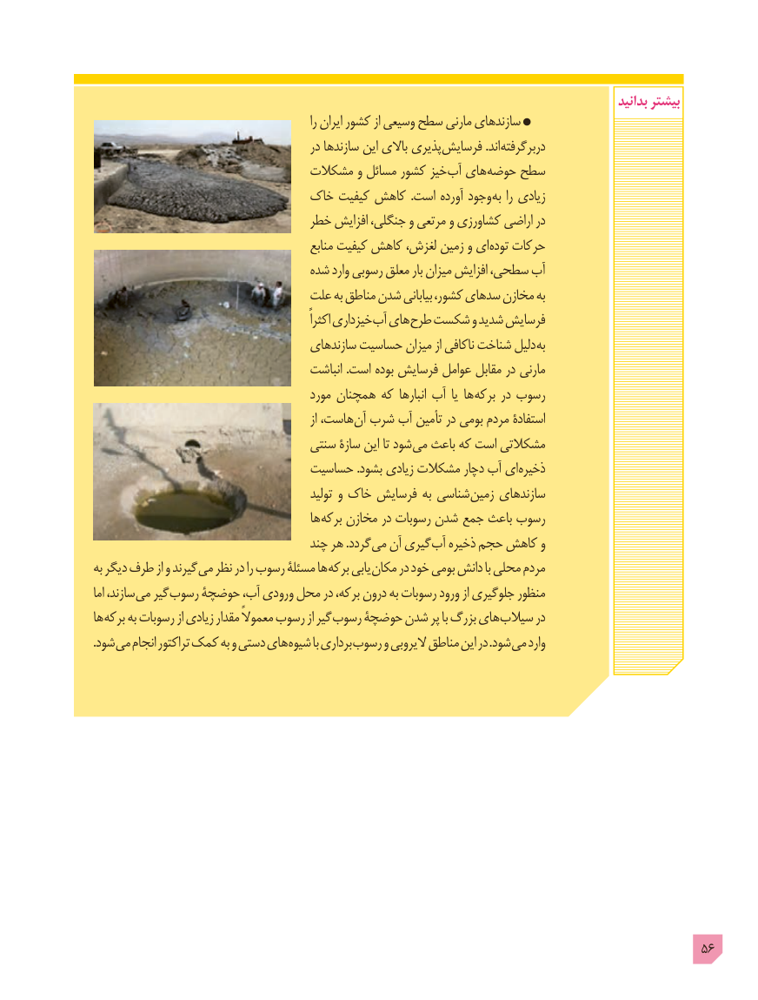

# PDF page 56

بدانید بیشتر
                                                             را ایران کشور از وسیعی سطح مارنی سازندهای
                                           در سازندها این باالی پذیری فرسایش .اند دربرگرفته
                              مشکالت و مسائل کشور خیز آب های حوضه سطح
                           خاک کیفیت کاهش  .است آورده وجود به را زیادی
                              خطر افزایش جنگلی، و مرتعی و کشاورزی اراضی در
                                               منابع کیفیت کاهش لغزش، زمین و ای توده حرکات
                                 شده وارد رسوبی معلق بار میزان افزایش سطحی، آب
                              علت به مناطق شدن بیابانی کشور، سدهای مخازن به
                                                               اکثراً خیزداری آب های طرح شکست و شدید فرسایش
                                     سازندهای حساسیت میزان از ناکافی شناخت دلیل به
                                        انباشت .است بوده فرسایش عوامل مقابل در مارنی
                                         مورد همچنان که انبارها آب یا ها برکه در رسوب
                                                             از هاست، آن شرب آب تأمین در بومی مردم استفادۀ
                                 سنتی سازۀ این تا شود می باعث که است مشکالتی
                              حساسیت .بشود زیادی مشکالت دچار آب ای ذخیره
                                                تولید و خاک فرسایش به شناسی زمین سازندهای
                                         ها برکه مخازن در رسوبات شدن  جمع باعث رسوب
                                    چند هر .گردد می آن گیری آب ذخیره حجم کاهش و
به دیگر طرف از و گیرند می نظر در را رسوب مسئلۀ ها برکه یابی مکان در خود بومی دانش با محلی مردم
اما سازند، می گیر رسوب حوضچۀ آب، ورودی محل در برکه، درون به رسوبات ورود از جلوگیری منظور
ها برکه به رسوبات از زیادی مقدار معموالً رسوب از گیر رسوب حوضچۀ شدن پر با بزرگ های سیالب در
. شود می انجام تراکتور کمک به و دستی های شیوه با برداری رسوب و الیروبی مناطق این در .شود می وارد

                                                                                          56

