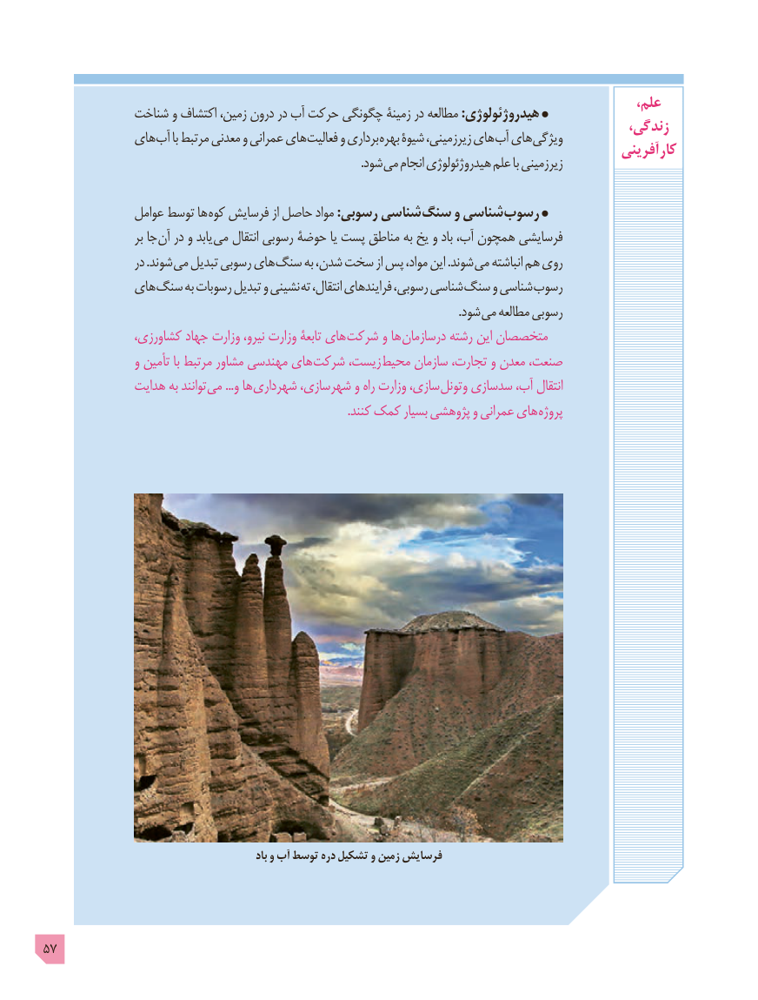

# PDF page 57

،علم             شناخت و اکتشاف زمین، درون در آب حرکت چگونگی زمینۀ در مطالعه :هیدروژئولوژی                                                                                       زندگی،             های آب با مرتبط معدنی و عمرانی های فعالیت و برداری بهره شیوۀ زیرزمینی، های آب های ویژگی                                                                                            آفرینی  کار                         . شود می انجام هیدروژئولوژی علم با زیرزمینی

               عوامل توسط ها کوه فرسایش از حاصل مواد :رسوبی شناسی سنگ و شناسی رسوب
                    بر جا آن در و یابد می انتقال رسوبی حوضۀ یا پست مناطق به یخ و باد آب، همچون فرسایشی
                  در .شوند می تبدیل رسوبی های سنگ به شدن، سخت از پس مواد، این .شوند می انباشته هم روی
             های سنگ به رسوبات تبدیل و نشینی ته انتقال، فرایندهای رسوبی، شناسی سنگ و شناسی رسوب
                                . شود می مطالعه رسوبی
               کشاورزی، جهاد وزارت نیرو، وزارت تابعۀ های شرکت و ها درسازمان رشته این متخصصان
                 و تأمین با مرتبط مشاور مهندسی های شرکت زیست، محیط سازمان تجارت، و معدن صنعت،
              هدایت به توانند می ...و ها شهرداری شهرسازی، و راه وزارت سازی، وتونل سدسازی آب، انتقال
                                                                                                       .کنند کمک بسیار پژوهشی و عمرانی های پروژه

                                                       باد و آب توسط دره تشکیل و زمین فرسایش

57

