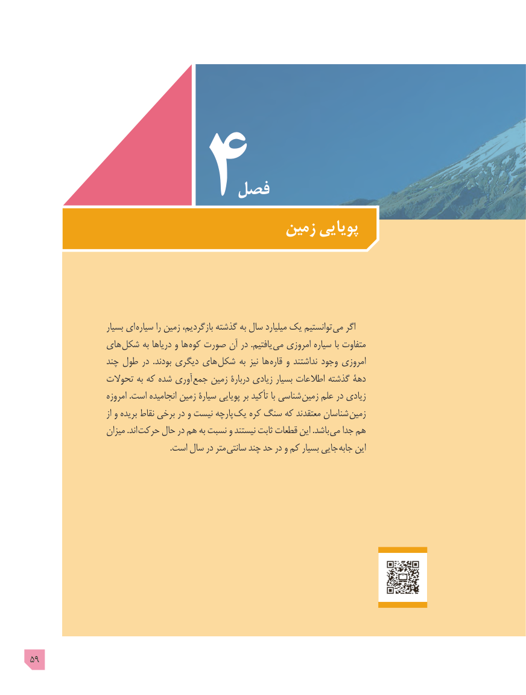

# PDF page 59

فصل
                                  زمین پویایی

                      بسیار ای  سیاره را زمین بازگردیم، گذشته به سال میلیارد یک توانستیم می اگر
               های  شکل به دریاها و ها کوه صورت آن در .یافتیم می امروزی سیاره با متفاوت
                  چند طول در  .بودند دیگری های  شکل به نیز ها قاره و نداشتند وجود امروزی
                 تحوالت به که شده آوری جمع زمین دربارۀ زیادی بسیار اطالعات گذشته دهۀ
                       امروزه .است انجامیده زمین سیارۀ پویایی بر تأکید با شناسی زمین علم در زیادی
                              از و بریده نقاط برخی در و نیست پارچه یک کره سنگ که معتقدند شناسان زمین
                    میزان .اند حرکت حال در هم به نسبت و نیستند ثابت قطعات این .باشد می جدا هم
                                                                    .است سال در متر  سانتی چند حد در و کم بسیار جایی جابه این

59

