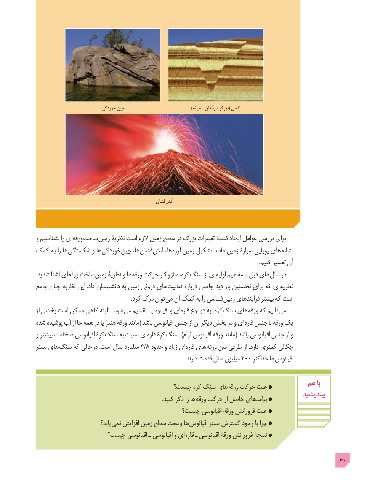

# PDF page 60

خوردگی چین                                                )میانه ـ زنجان بزرگراه( گسل

                                                   فشان آتش

و بشناسیم را ای ورقه ساخت زمین نظریۀ است الزم زمین سطح در بزرگ تغییرات کنندۀ ایجاد عوامل بررسی برای
کمک به را ها شکستگی و ها خوردگی چین ها، فشان آتش ها، لرزه زمین تشکیل مانند زمین سیارۀ پویایی های نشانه
                                                                                                                                                            .کنیم تفسیر آن
.شدید آشنا ای ورقه ساخت زمین نظریۀ و ها ورقه حرکت کار و ساز کره، سنگ از ای اولیه مفاهیم با قبل های سال در
جامع چنان نظریه این .داد دانشمندان به زمین درونی های فعالیت دربارۀ جامعی دید بار نخستین برای که ای نظریه
                                                                  .کرد درک توان می آن کمک به را شناسی زمین فرایندهای بیشتر که است
از بخشی است ممکن گاهی البته .شوند می تقسیم اقیانوسی و ای قاره نوع دو به کره، سنگ های ورقه که دانیم می
شده پوشیده آب از جا همه در یا )هند ورقه مانند( باشد اقیانوسی جنس از آن دیگر بخش در و ای قاره جنس با ورقه یک
و بیشتر ضخامت اقیانوسی کرۀ سنگ به نسبت ای قاره کرۀ سنگ ).آرام اقیانوس ورقه مانند( باشد اقیانوسی جنس از و
بستر های سنگ که حالی در .است سال میلیارد 3/8 حدود و زیاد ای قاره های ورقه سن طرفی از .دارد کمتری چگالی
         .200دارند قدمت سال میلیون     حداکثر ها اقیانوس

                                                                        هم با                                      چیست؟ کره سنگ های ورقه حرکت علت
                                                                                             بیندیشید                                                                                        .کنید ذکر را ها ورقه حرکت از حاصل پیامدهای
                                        چیست؟ اقیانوسی ورقه فرورانش علت
                              یابد؟  نمی افزایش زمین سطح وسعت ها اقیانوس بستر گسترش وجود با چرا
                    چیست؟ اقیانوسی ـ اقیانوسی و ای قاره ـ اقیانوسی ورقۀ فرورانش نتیجۀ

                                                                                            60

