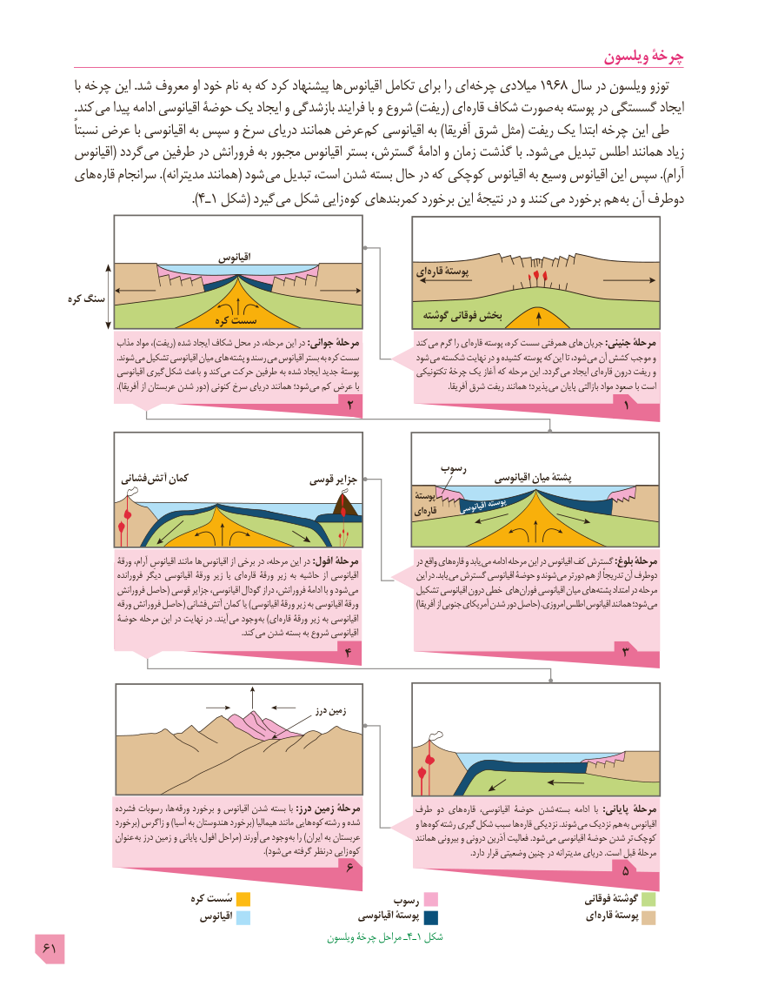

# PDF page 61

ویلسون چرخۀ
          با چرخه این .شد معروف او خود نام به که کرد پیشنهاد ها  اقیانوس تکامل برای را ای چرخه میالدی 1968 سال در ویلسون توزو
          .کند می پیدا ادامه اقیانوسی حوضۀ یک ایجاد و بازشدگی فرایند با و شروع )ریفت( ای قاره شکاف صورت به پوسته در گسستگی ایجاد
        نسبتاً عرض با اقیانوسی به سپس و سرخ دریای همانند عرض کم اقیانوسی به )آفریقا شرق مثل( ریفت یک ابتدا چرخه این طی
      اقیانوس( گردد می طرفین در فرورانش به مجبور اقیانوس بستر گسترش، ادامۀ و زمان گذشت با .شود می تبدیل اطلس همانند زیاد
    های قاره سرانجام ).مدیترانه همانند( شود می تبدیل است، شدن بسته حال در که کوچکی اقیانوس به وسیع اقیانوس این سپس ).آرام
                                ).4ـ1 شکل( گیرد می شکل زایی  کوه کمربندهای برخورد این نتیجۀ در و کنند می برخورد هم به آن دوطرف

                                      اقیانوس
                                                                     ای  قاره پوستۀ

     کره سنگ
                                                                          گوشته فوقانی بخش                                     کره سست
                 مذاب مواد ،)ریفت( شده ایجاد شکاف محل در مرحله، این در :جواني مرحلة               کند می گرم را ای قاره پوسته کره، سست همرفتی های جریان :جنيني مرحلۀ
                                     .شوند می تشکیل اقیانوسی میان های  پشته و رسند می اقیانوس بستر به کره سست             شود می شکسته نهایت در و کشیده پوسته که  این تا شود، می آن کشش موجب و
                     اقيانوسي گيري شكل باعث و کند می حرکت طرفین به شده ایجاد جدید پوستۀ               تکتونیکی چرخۀ یک آغاز که مرحله این .گردد می ایجاد ای  قاره درون ریفت و
                                ).آفریقا از عربستان شدن دور( كنوني سرخ درياي همانند شود؛ مي كم عرض با  . آفریقا شرق ریفت همانند پذیرد؛ می پایان بازالتی مواد صعود با است
                                            2                                       1

                                                             رسوب
               فشانی  آتش کمان                    قوسی جزایر                               اقیانوسی میان پشتۀ
                                                                                          پوستۀ
                                                                                ای قاره      اقیانوسیپوسته

                     ورقۀ آرام، اقیانوسِ مانند ها اقیانوس از برخی در مرحله، این در :افول مرحلۀ                 در واقع هاي قاره و یابد می ادامه مرحله اين در اقيانوس كف گسترش :بلوغ مرحلة
                       فرورانده دیگر اقیانوسی ورقۀ زیر یا ای قاره ورقۀ زیر به حاشیه از اقیانوسی                 اين در .يابد مي گسترش اقيانوسي حوضۀ و شوند می دورتر هم از  تدريجاًدوطرفآن
                   فرورانش حاصل( قوسی جزایر اقیانوسی، گودال دراز فرورانش، ادامۀ با و شود می             تشکیل اقيانوسي درون خطی هاي فوران اقيانوسي ميان هاي پشته امتداد در مرحله
                     ورقه فرورانش حاصل( فشانی آتش کمان یا )اقیانوسی ورقۀ زیر به اقیانوسی ورقۀ ) آفریقا از جنوبی آمریکای شدن دور حاصل( .امروزي اطلس اقيانوس همانند شود؛ مي
               حوضۀ مرحله این در نهایت در .آیند  می وجود به )ای قاره ورقۀ زیر به اقیانوسی
                         . کند می شدن بسته به شروع اقیانوسی
                                           4                                       3

                                                                      درز زمین

                  فشرده رسوبات ها، ورقه برخورد و اقیانوس شدن بسته با :درز زمین مرحلۀ          طرف دو های  قاره اقیانوسی، حوضۀ شدن بسته ادامه  با  :پایانی مرحلۀ
                    برخورد( زاگرس و )آسیا به هندوستان برخورد( هیمالیا مانند هایی  کوه رشته و شده               و ها کوه رشته گیری شکل سبب ها قاره نزدیکی .شوند  می نزدیک هم به اقیانوس
                   عنوان  به درز زمین و پایانی افول، مراحل( آورند می وجود به را )ایران به عربستان                همانند بیرونی و درونی آذرین فعالیت .شود  می اقیانوسی حوضۀ شدن تر کوچک
                                 ). شود می گرفته درنظر زایی  کوه                                                        .دارد قرار وضعیتی چنین در مدیترانه دریای .است قبل مرحلۀ
                                            6                                       5
                                کره سُست                         رسوب                                      فوقانی گوشتۀ
                                  اقیانوس                            اقیانوسی پوستۀ                               ای قاره پوستۀ
                                                              ویلسون چرخۀ مراحل ـ4ـ1 شکل
61

