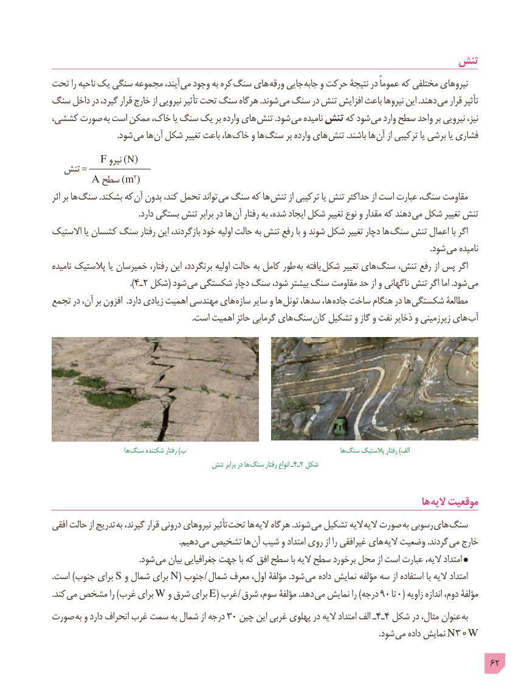

# PDF page 62

تنش
تحت را ناحیه یک سنگی مجموعه آیند، می وجود به کره  سنگ های ورقه جایی جابه و حرکت نتیجۀ در عموماً که مختلفی نیروهای
سنگ داخل در گیرد، قرار خارج از نیرویی تأثیر تحت سنگ هرگاه .شوند می سنگ در تنش افزایش باعث نیروها این .دهند می قرار تأثیر
کششی، صورت به است ممکن خاک، یا سنگ یک بر وارده های تنش .شود  می نامیده تنش که شود می وارد سطح واحد بر نیرویی نیز،
                                .شود می ها آن شکل تغییر باعث ها، خاک و ها سنگ بر وارده های  تنش .باشند ها آن از ترکیبی یا برشی یا فشاری
        F نیرو ) N(  تنش = __________
     A سطح )m2(
اثر بر ها  سنگ .بشکند که آن بدون کند، تحمل تواند می سنگ که ها تنش از ترکیبی یا تنش حداکثر از است عبارت سنگ، مقاومت
  . دارد بستگی تنش برابر در ها آن رفتار به شده، ایجاد شکل تغییر نوع و مقدار که دهند  می شکل تغییر تنش
االستیک یا کشسان سنگ رفتار این بازگردند، خود اولیه حالت به تنش رفع با و شوند شکل تغییر دچار ها  سنگ تنش اعمال با اگر
                                         . شود می نامیده
نامیده پالستیک یا خمیرسان رفتار، این برنگردد، اولیه حالت به کامل طور  به یافته شکل تغییر های  سنگ تنش، رفع از پس اگر
                                ).٤ـ٢ شکل( شود می شکستگی دچار سنگ شود، بیشتر سنگ مقاومت حد از و ناگهانی تنش اگر اما .شود  می
تجمع در آن، بر افزون  .دارد زیادی اهمیت مهندسی های سازه سایر و ها  تونل سدها، ها، جاده ساخت هنگام در ها شکستگی مطالعۀ
   . است اهمیت حائز گرمابی های سنگ  کان تشکیل و گاز و نفت ذخایر و زیرزمینی های آب

                           ها سنگ شکننده رفتار )ب                                                         ها  سنگ پالستیک رفتار )الف
                                        تنش برابر در ها  سنگ رفتار انواع ـ4ـ2 شکل

                                                                                        ها الیه موقعیت
افقی حالت از تدریج به گیرند، قرار درونی نیروهای تأثیر  تحت ها الیه هرگاه .شوند می تشکیل الیه الیه صورت به رسوبی های سنگ
            . دهیم می تشخیص ها  آن شیب و امتداد روی از را غیرافقی های الیه وضعیت .گردند  می خارج
         . شود می بیان جغرافیایی جهت با که افق سطح با الیه سطح برخورد محل از است عبارت الیه، امتداد
.است )جنوب برای S و شمال برای N( جنوب  / شمال معرف اول، مؤلفۀ .شود می داده نمایش مؤلفه سه از استفاده با الیه امتداد
. کند می مشخص را )غرب برای W و شرق برای E( غرب  / شرق سوم، مؤلفۀ .دهد می۹۰نمایش را )درجه     تا ۰ ( زاویه اندازه دوم، مؤلفۀ
صورت  به و دارد انحراف غرب سمت به شمال از درجه 30 چین این غربی پهلوی در الیه امتداد الف ـ4ـ4 شکل در مثال، عنوان  به
                                   . شود می داده نمایش N30W
                                                                                            62

