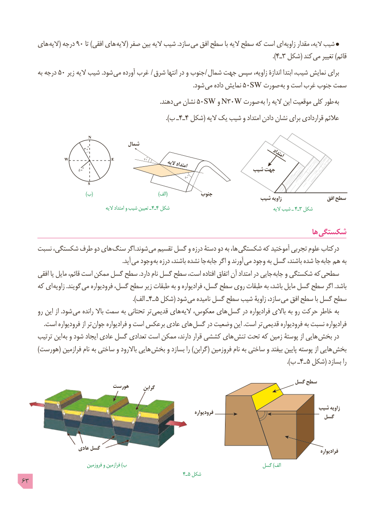

# PDF page 63

های الیه( درجه 90 تا )افقی های الیه( صفر بین الیه شیب .سازد  می افق سطح با الیه سطح که است ای  زاویه مقدار الیه، شیب
                                                                                                                                                .)٤ـ3 شکل( کند می تغییر )قائم
      به درجه 50 زیر الیه شیب .شود می آورده غرب  / شرق انتها در و جنوب  / شمال جهت سپس زاویه، اندازۀ ابتدا شیب، نمایش برای
                          . شود می داده نمایش 50SW صورت به و است غرب جنوب سمت
                                                                                            .دهند می نشان 50SW و N30W صورت به را الیه این موقعیت کلی طور به
                                                                                   ).ب ـ٤ـ4 شکل( الیه یک شیب و امتداد دادن نشان برای قراردادی عالئم

                        N
                                     شمال                                   300
                                                                                                      امتداد
           W                 E                      300        الیه                                                                      امتداد                             500                                                 شیب جهت
                                                                                                                          500
                              S
                  )(ب              )(الف            جنوب                                                                     شیب زاویه                   افق سطح
                                              الیه امتداد و شیب تعیین ـ 4ـ4 شکل                                                        الیه شیب ـ 4ـ3 شکل

                                                                                                ها شکستگی
    نسبت شکستگی، طرف دو های  سنگ اگر.شوند می تقسیم گسل و درزه دستۀ دو به ها،  شکستگی که آموختید تجربی علوم درکتاب
                   . آید می وجود به درزه باشند، نشده جا جابه اگر و آورند  می وجود به گسل باشند، شده جا  جابه هم به
      افقی یا مایل قائم، است ممکن گسل سطح .دارد نام گسل سطح است، افتاده اتفاق آن امتداد در جایی  جابه و شکستگی که  سطحی
     که ای  زاویه .گویند می فرودیواره گسل، سطح زیر طبقات به و فرادیواره گسل، سطح روی طبقات به باشد، مایل گسل سطح اگر .باشد
                                                                ).الف ـ4ـ ٥ شکل( شود می نامیده گسل سطح شیب زاویۀ سازد، می افق سطح با گسل سطح
      رو این از .شود می رانده باال سمت به تحتانی تر  قدیمی های الیه معکوس، های گسل در فرادیواره باالی به رو حرکت خاطر به
 . است فرودیواره از تر جوان فرادیواره و است برعکس عادی های گسل در وضعیت این .است تر قدیمی فرودیواره به نسبت فرادیواره
     ترتیب این  به و شود ایجاد عادی گسل تعدادی است ممکن دارند، قرار کششی های تنش تحت که زمین پوستۀ از هایی  بخش در
        )هورست( فرازمین نام به ساختی و باالرود هایی  بخش و بسازد را )گرابن( فروزمین نام به ساختی و بیفتد پایین پوسته از هایی  بخش
                                               ).4ب ـ ـ ٥ شکل( بسازد را

                                                                                 گسل سطح
                            هورست      گرابن

                                                                                      شیب زاویه                                                                                  فرودیواره                                                                                          گسل

                     عادی گسل                                                                                                                                                       فرادیواره
                              فروزمین و فرازمین )ب                                            گسل )الف
                                                             4ـ ٥ شکل
63

