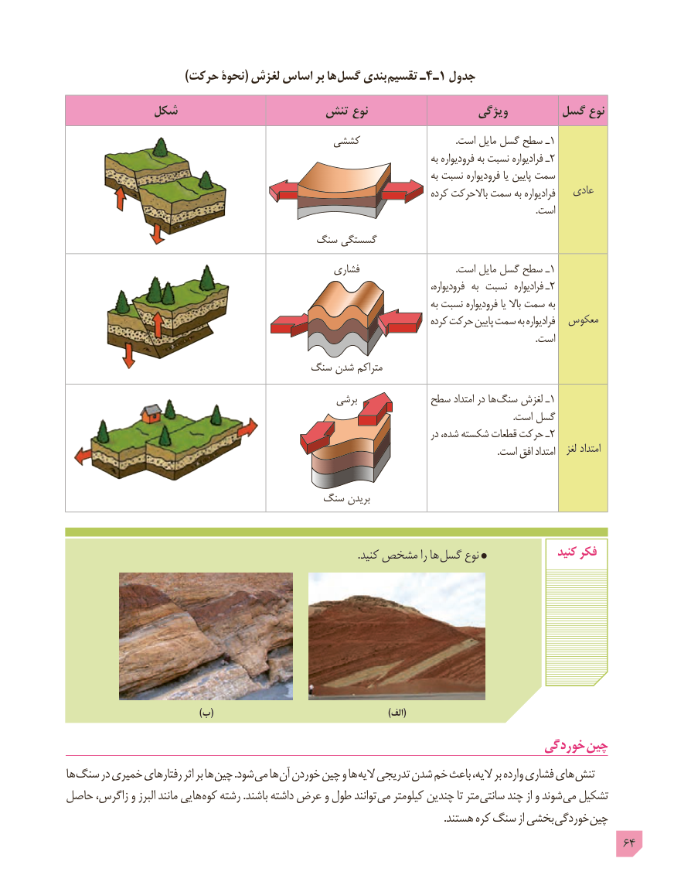

# PDF page 64

)حرکت نحوۀ( لغزش اساس بر ها گسل بندی تقسیم ـ4ـ1 جدول

           شکل                   تنش نوع                  ویژگی       گسل نوع
                                       کششی                                         .است مایل گسل سطح ـ1
                                                                                                 به فرودیواره به نسبت فرادیواره ـ 2
                                                                                                 به نسبت فرودیواره یا پایین سمت
                                                                                  کرده باالحرکت سمت به فرادیواره   عادی
                                                                                                                                                                                                         .است
                                   سنگ گسستگی
                                                   فشاری  .1است مایل گسل سطح ـ
                                ،فرادیوارهفرودیواره  به نسبت                 ـ2
                                                                                                 به نسبت فرودیواره یا باال سمت به
                                                                                     کرده حرکت پایین سمت به فرادیواره  معکوس
                                                                                                                                                                                                         . است
                                   سنگ شدن متراکم
                                                   برشی           سطح امتداد در ها سنگ لغزش ـ1
                                                                                                                                                                                               .است گسل
                                                                                          در شده، شکسته قطعات حرکت ـ2
                                                                                                                                                                                         .است افق امتداد   لغز امتداد

                                    سنگ بریدن

                                                                                                               .کنید مشخص را ها گسل نوع                کنید فکر

                                            )ب(                   )(الف
                                                                     خوردگی چین
ها سنگ در خمیری رفتارهای اثر بر ها چین .شود می ها آن خوردن چین و ها الیه تدریجی شدن خم باعث الیه، بر وارده فشاری های تنش
حاصل زاگرس، و البرز مانند هایی کوه رشته .باشند داشته عرض و طول توانند می کیلومتر چندین تا متر ﻣﯽ ﺷﻮﻧﺪسانتی چند از و       ﺗﺸﮑﯿﻞ
                                                                                                                                                .هستند کره سنگ از بخشی خوردگی چین
                                                                                            64

