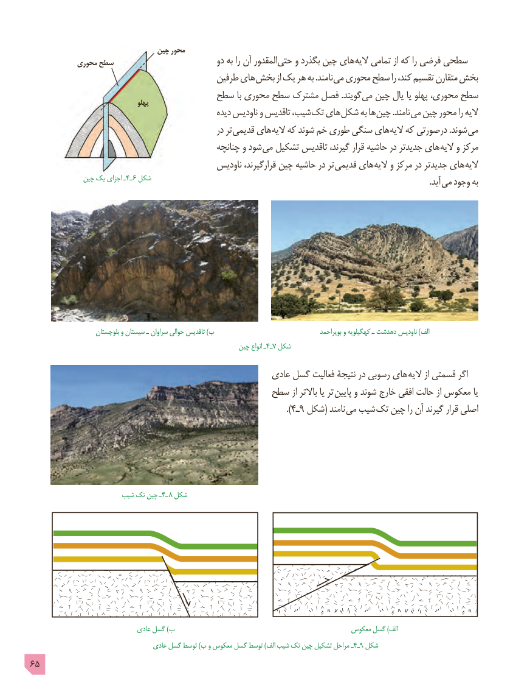

# PDF page 65

چین محور
            محوری سطح                           دو به را آن المقدور حتی و بگذرد چین های الیه تمامی از که را فرضی سطحی
                                         طرفین های بخش از یک هر به .نامند می محوری سطح را کند، تقسیم متقارن بخش
                               سطح با محوری سطح مشترک فصل .گویند می چین یال یا پهلو محوری، سطح                                     پهلو
                                                   دیده ناودیس و تاقدیس شیب، تک های شکل به ها چین .نامند می چین محور را الیه
                                                    در تر قدیمی های الیه که شوند خم طوری سنگی های الیه که درصورتی .شوند می
                                                چنانچه و شود می تشکیل تاقدیس گیرند، قرار حاشیه در جدیدتر های الیه و مرکز
                                            ناودیس قرارگیرند، چین حاشیه در تر قدیمی های الیه و مرکز در جدیدتر های الیه
              چین یک اجزای ـ4ـ ٦ شکل                                       . آید می وجود به

                      بلوچستان و سیستان ـ سراوان حوالی تاقدیس )ب                                       بویراحمد و کهگیلویه ـ دهدشت ناودیس )الف
                                                         چین انواع ـ4٧ـ شکل
                                                    عادی گسل فعالیت نتیجۀ در رسوبی های الیه از قسمتی اگر
                                         سطح از باالتر یا تر پایین و شوند خارج افقی حالت از معکوس یا
                                                                               ).4ـ٩ شکل( نامند می شیب تک چین را آن گیرند قرار اصلی

                      شیب تک چین ـ4ـ ٨ شکل

                               عادی گسل )ب                                            معکوس گسل )الف
                                   عادی گسل توسط )ب و معکوس گسل توسط )الف شیب تک چین تشکیل مراحل ـ4ـ٩ شکل
65

