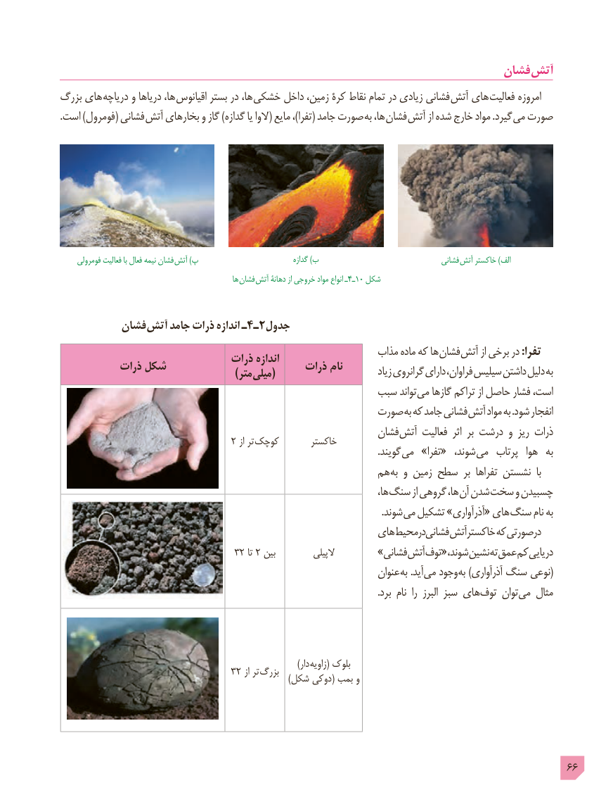

# PDF page 66

فشان آتش
بزرگ های  دریاچه و دریاها ها، اقیانوس بستر در ها، خشکی داخل زمین، کرۀ نقاط تمام در زیادی فشانی آتش های فعالیت امروزه
. است )فومرول( فشانی آتش بخارهای و گاز )گدازه یا الوا( مایع ،)تفرا( جامد صورت به ها، فشان آتش از شده خارج مواد .گیرد  می صورت

     فومرولی فعالیت با فعال نیمه فشان  آتش )پ                               گدازه )ب                                  فشانی آتش خاکستر )الف
                                                       ها فشان  آتش دهانۀ از خروجی مواد انواع ـ4ـ10 شکل

          فشان آتش جامد ذرات اندازه ـ4ـ2جدول
                                                              مذاب ماده که ها فشان آتش از برخی در :تفرا                               ذرات اندازه           ذرات شکل                                             ذرات نام          زیاد گرانروی دارای فراوان، سیلیس داشتن دلیل به             ) (متر میلی
                                                 سبب تواند می گازها تراکم از حاصل فشار است،
                                                 صورت به که جامد فشانی آتش مواد به .شود انفجار
                                                            فشان آتش فعالیت  اثر بر درشت و ریز ذرات                                  2 از تر کوچک       خاکستر                        . گویند می »تفرا«  شوند، می  پرتاب  هوا  به
                                                    هم به و زمین سطح بر تفراها نشستن  با
                                                                                       ها، سنگ از گروهی ها، آن شدن سخت و چسبیدن
                          . شوند می تشکیل »آذرآواری« های سنگ نام به
                                                       های محیطدرفشانی آتشخاکستر که صورتیدر
                                  32 تا 2 بین          الپیلی       »فشانی آتش توف« شوند، نشین ته عمق کم دریایی
                                                                       عنوان به .آید می وجود (به )آذرآواری سنگ نوعی
      . برد نام  را  البرز سبز های توف توان می مثال

                                                                                    )دار زاویه( بلوک
         )32از تر بزرگ  شکل دوکی( بمب و

                                                                                            66

