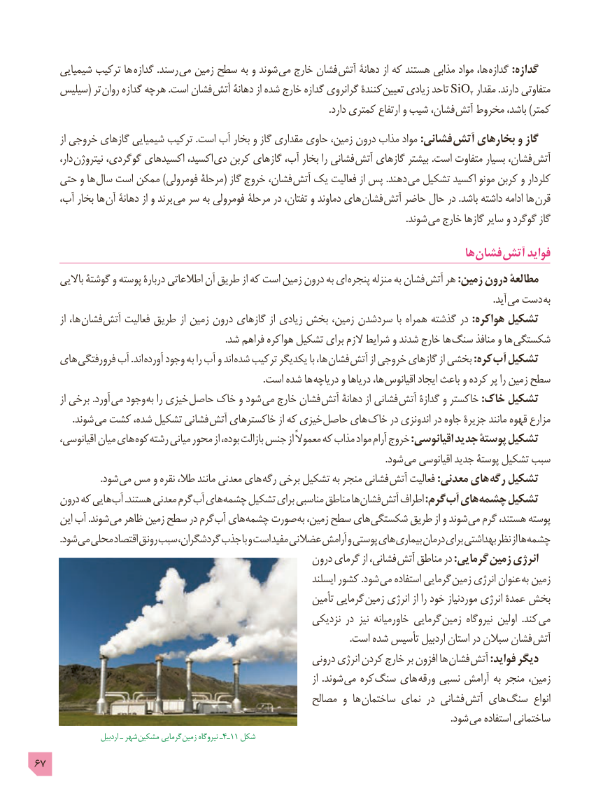

# PDF page 67

شیمیایی ترکیب ها گدازه .رسند می زمین سطح به و شوند می خارج فشان آتش دهانۀ از که هستند مذابی مواد ها،  گدازه :گدازه
    سیلیس( تر روان گدازه هرچه .است فشان  آتش دهانۀ از شده خارج گدازه گرانروی کنندۀ تعیین زیادی تاحد SiO2 مقدار .دارند متفاوتی
                                                                                                                           .دارد کمتری ارتفاع و شیب فشان،  آتش مخروط باشد، )کمتر
        از خروجی گازهای شیمیایی ترکیب .است آب بخار و گاز مقداری حاوی زمین، درون مذاب مواد :فشانی آتش بخارهای و گاز
        دار، نیتروژن گوگردی، اکسیدهای اکسید، دی کربن گازهای آب، بخار را فشانی  آتش گازهای بیشتر .است متفاوت بسیار فشان،  آتش
    حتی و ها سال است ممکن )فومرولی مرحلۀ( گاز خروج فشان،  آتش یک فعالیت از پس .دهند می تشکیل اکسید مونو کربن و کلردار
     آب، بخار ها  آن دهانۀ از و برند می سر به فومرولی مرحلۀ در تفتان، و دماوند های فشان آتش حاضر حال در .باشد داشته ادامه ها  قرن
                              . شوند می خارج گازها سایر و گوگرد گاز

                                                                                         ها فشان آتش فواید
      باالیی گوشتۀ و پوسته دربارۀ اطالعاتی آن طریق از که است زمین درون به ای پنجره منزله به فشان آتش هر :زمین درون مطالعۀ
                                                       . آید می دست  به
        از ها، فشان  آتش فعالیت طریق از زمین درون گازهای از زیادی بخش زمین، سردشدن با همراه گذشته در :هواکره تشکیل
                                                                                .شد فراهم کره  هوا تشکیل برای الزم شرایط و شدند خارج ها سنگ منافذ و ها  شکستگی
    های  فرورفتگی آب .اند  آورده وجود به را آب و اند شده ترکیب یکدیگر با ها، فشان آتش از خروجی گازهای از بخشی :کره  آب تشکیل
                                                                                                                                 .است شده ها دریاچه و دریاها ها، اقیانوس ایجاد باعث و کرده پر را زمین سطح
        از برخی .آورد می وجود به را خیزی حاصل خاک و شود می خارج فشان  آتش دهانۀ از فشانی  آتش گدازۀ و خاکستر :خاک تشکیل
   . شوند می کشت شده، تشکیل فشانی  آتش خاکسترهای از که خیزی حاصل های خاک در اندونزی در جاوه جزیرۀ مانند قهوه مزارع
      اقیانوسی، میان های کوه رشته میانی محور از بوده، بازالت جنس از معموالً که مذاب مواد آرام خروج :اقیانوسی جدید پوستۀ تشکیل
                                 . شود می اقیانوسی جدید پوستۀ تشکیل سبب
                           .شود می مس و نقره طال، مانند معدنی های  رگه برخی تشکیل به منجر فشانی آتش فعالیت :معدنی های رگه تشکیل
     درون که هایی آب .هستند معدنی گرم آب های چشمه تشکیل برای مناسبی مناطق ها فشان آتش اطراف :گرم آب های چشمه تشکیل
      این آب .شوند می ظاهر زمین سطح در گرم آب های چشمه صورت به زمین، سطح های شکستگی طریق از و شوند می گرم هستند، پوسته
          .شود می محلی اقتصاد رونق سبب گردشگران، جذب با و است مفید عضالنی آرامش و پوستی های بیماری درمان برای بهداشتی نظر از ها چشمه
                                                       درون گرمای از فشانی،  آتش مناطق در :گرمایی زمین انرژی
                                                                      ایسلند کشور .شود می استفاده گرمایی  زمین انرژی عنوان به زمین
                                                                تأمین گرمایی  زمین انرژی از را خود موردنیاز انرژی عمدۀ بخش
                                                          نزدیکی در نیز خاورمیانه گرمایی  زمین نیروگاه اولین  .کند می
   . است شده تأسیس اردبیل استان در سبالن فشان آتش
                                                            درونی انرژی کردن خارج بر افزون ها  فشان  آتش :فواید دیگر
                                                                                              از  .شوند می کره  سنگ های ورقه نسبی آرامش به منجر زمین،
                                                       مصالح و ها ساختمان نمای در فشانی  آتش های سنگ  انواع
                                       . شود می استفاده ساختمانی
                      اردبیل ـ شهر مشکین گرمایی زمین نیروگاه ـ4ـ11 شکل
67

