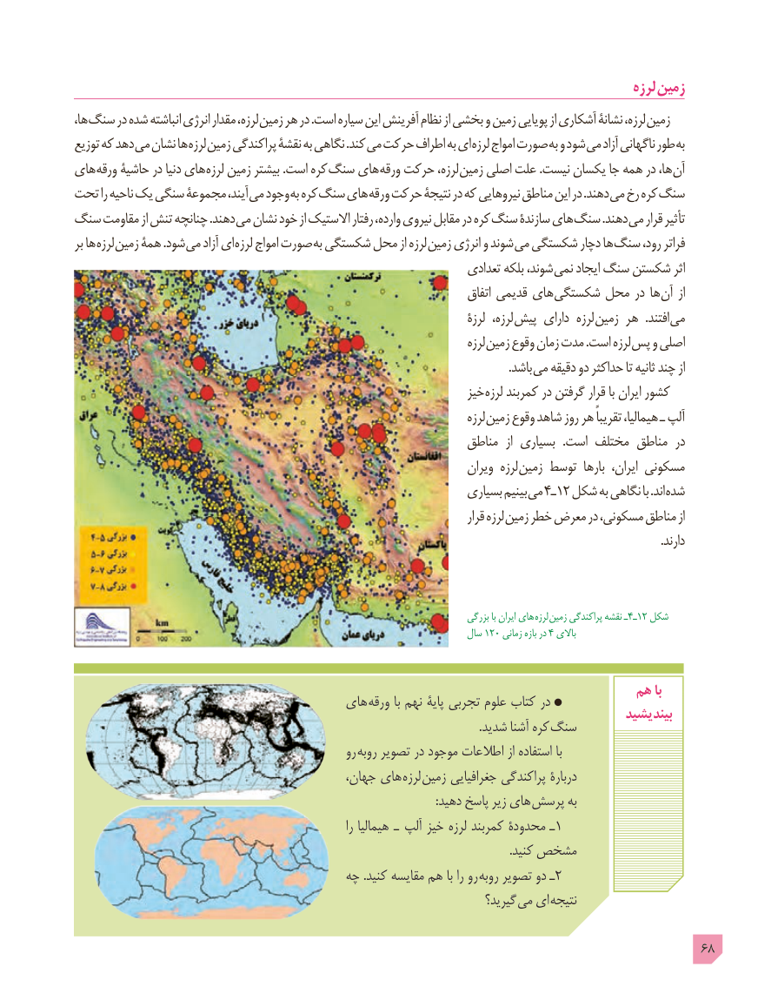

# PDF page 68

لرزه زمین
ها، سنگ در شده انباشته انرژی مقدار لرزه، زمین هر در .است سیاره این آفرینش نظام از بخشی و زمین پویایی از آشکاری نشانۀ لرزه، زمین
توزیع که دهد می نشان ها لرزه زمین پراکندگی نقشۀ به نگاهی .کند می حرکت اطراف به ای لرزه امواج صورت به و شود می آزاد ناگهانی طور به
های ورقه حاشیۀ در دنیا های لرزه زمین بیشتر .است کره سنگ های ورقه حرکت لرزه، زمین اصلی علت .نیست یکسان جا همه در ها، آن
تحت را ناحیه یک سنگی مجموعۀ آیند، می وجود به کره سنگ های ورقه حرکت نتیجۀ در که نیروهایی مناطق این در .دهند می رخ کره سنگ
سنگ مقاومت از تنش چنانچه .دهند می نشان خود از االستیک رفتار وارده، نیروی مقابل در کره سنگ سازندۀ های سنگ .دهند می قرار تأثیر
بر ها لرزه زمین همۀ .شود می آزاد ای لرزه امواج صورت به شکستگی محل از لرزه زمین انرژی و شوند می شکستگی دچار ها سنگ رود، فراتر
                                                                      تعدادی بلکه شوند، نمی ایجاد سنگ شکستن اثر
                                                                                   اتفاق قدیمی های شکستگی محل در ها آن از
                                                                                      لرزۀ  لرزه، پیش دارای لرزه زمین هر  .افتند می
                                                                                      لرزه زمین وقوع زمان مدت .است لرزه پس و اصلی
                               . باشد می دقیقه دو حداکثر تا ثانیه چند از
                                                                    خیز لرزه کمربند در گرفتن قرار با ایران کشور
                                                                                      لرزه زمین وقوع شاهد روز هر تقریباً هیمالیا، ـ آلپ
                                                               مناطق  از بسیاری  .است مختلف مناطق در
                                                                           ویران لرزه زمین توسط  بارها ایران، مسکونی
                                                                   بسیاری بینیم می 4ـ12 شکل به نگاهی با .اند شده
                                                                                          قرار لرزه زمین خطر معرض در مسکونی، مناطق از
                                                                                                                                                                                                      .دارند

                                                                                         بزرگی با ایران های  لرزه  زمین پراکندگی نقشه ـ4ـ12 شکل
                                                                             سال 120 زمانی بازه در 4 باالی

                                                                        هم با                                      های ورقه با نهم پایۀ تجربی علوم کتاب در                                                                                             بیندیشید                                                                                                                                         .شدید آشنا کره  سنگ
                                                    رو روبه تصویر در موجود اطالعات از استفاده با
                                             جهان، های لرزه زمین جغرافیایی پراکندگی دربارۀ
       : دهید پاسخ زیر های پرسش به
                                                                          را هیمالیا  ـ  آلپ خیز لرزه کمربند محدودۀ ـ1
                                                                                                                                                   .کنید مشخص
                                       چه .کنید مقایسه هم با را رو روبه تصویر دو ـ2
                                                                              گیرید؟ می ای نتیجه

                                                                                            68

