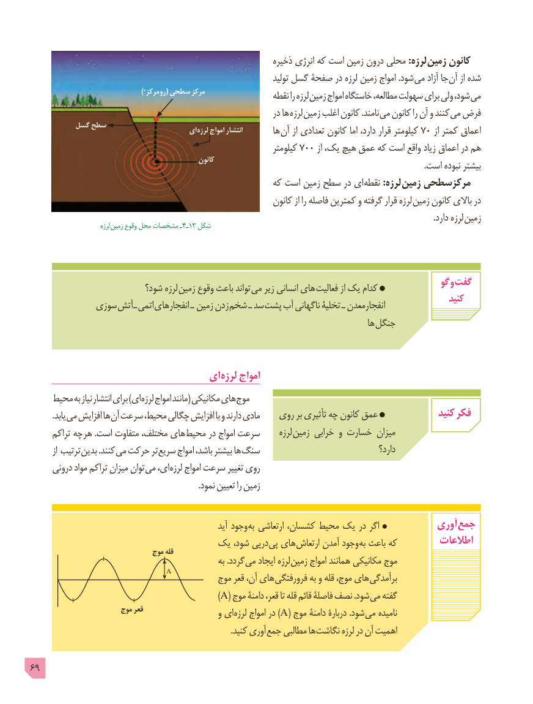

# PDF page 69

ذخیره انرژی که است زمین درون محلی :لرزه  زمین کانون
                                                                            تولید گسل صفحۀ در لرزه زمین امواج .شود می آزاد جا آن از شده
                                              )*مرکز  رو( سطحی مرکز                 نقطه را لرزه زمین امواج خاستگاه مطالعه، سهولت برای ولی شود، می
                                                                  در ها لرزه  زمین اغلب کانون .نامند می کانون را آن و کنند می فرض
          گسل سطح                                          ای لرزه امواج انتشار                                                                  ها 7آن از تعدادی کانون اما دارد، قرار کیلومتر  0 از کمتر اعماق
                                                                     کیلومتر 700 از یک، هیچ عمق که است واقع زیاد اعماق در هم
                                                     کانون                                                                                                     .است نبوده بیشتر
                                                      که است زمین سطح در ای  نقطه :لرزه  زمین مرکزسطحی
                                                              کانون از را فاصله کمترین و گرفته قرار لرزه  زمین کانون باالی در
                        . دارد لرزه زمین                             لرزه  زمین وقوع محل مشخصات ـ4ـ13 شکل

                                                                                            گو و گفت                          شود؟ لرزه  زمین وقوع باعث تواند می زیر انسانی های فعالیت از یک کدام
                                                                                                            کنید            سوزی آتش ـ اتمی انفجارهای ـ  زمین زدن شخم ـ سد پشت آب ناگهانی تخلیۀ ـ انفجارمعدن
                                                                                            ها جنگل

                                 ای لرزه امواج
         محیط به نیاز انتشار برای )ای لرزه امواج مانند( مکانیکی های موج
   . یابد می افزایش ها آن سرعت محیط، چگالی افزایش با و دارند مادی    روی بر تأثیری چه کانون عمق              کنید فکر
      تراکم چه هر .است متفاوت مختلف، های محیط در امواج سرعت      لرزه  زمین خرابی و خسارت میزان
         از ترتیب بدین .کنند می حرکت تر سریع امواج باشد، بیشتر ها سنگ                                    دارد؟
     درونی مواد تراکم میزان توان می ای، لرزه امواج سرعت تغییر روی
                                                                                 .نمود تعیین را زمین

                                                           آید وجود به ارتعاشی کشسان، محیط یک در اگر            آوری جمع
                             یک شود، درپی پی های ارتعاش آمدن وجود به باعث که         اطالعات                                موج قله
                                                        به .گردد می ایجاد لرزه زمین امواج همانند مکانیکی موج
                           A          موج قعر آن، های فرورفتگی به و قله موج، های برآمدگی
                                                                    )A( موج دامنۀ قعر، تا قله قائم فاصلۀ نصف .شود می گفته
                        موج قعر                   و ای )لرزه امواج در A( موج دامنۀ دربارۀ .شود می نامیده
          . کنید آوری جمع مطالبی ها نگاشت لرزه در آن اهمیت

69

