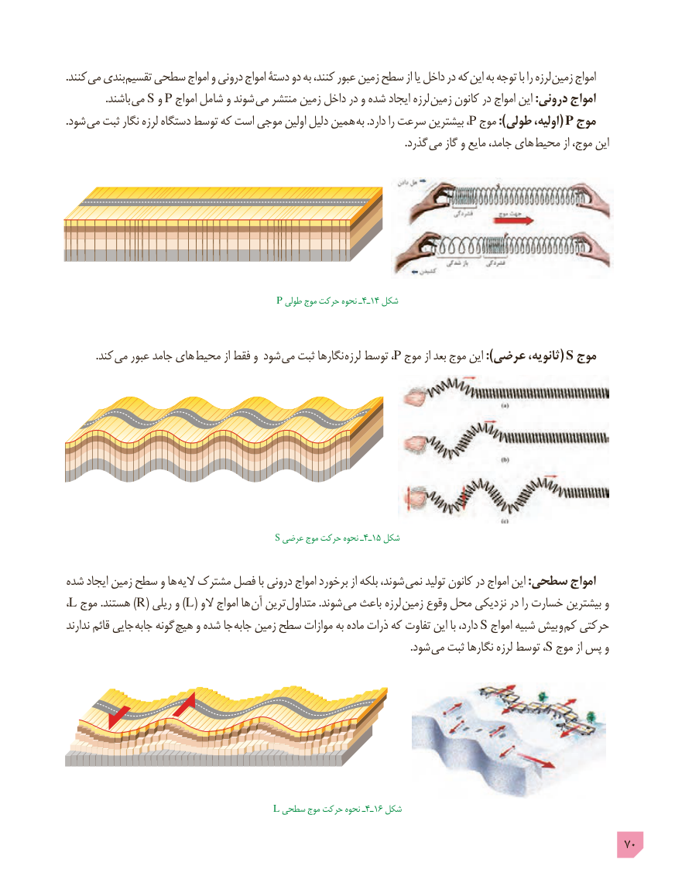

# PDF page 70

. کنند می بندی تقسیم سطحی امواج و درونی امواج دستۀ دو به کنند، عبور زمین سطح از یا داخل در که این به توجه با را لرزه زمین امواج
               .باشند  می S و P امواج شامل و شوند می منتشر زمین داخل در و شده ایجاد لرزه  زمین کانون در امواج این :درونی امواج
.شود می ثبت نگار لرزه دستگاه توسط که است موجی اولین دلیل همین به .دارد را سرعت بیشترین ،P موج ):طولی اولیه،( P موج
                                                                                                                                 .گذرد می گاز و مایع جامد، های محیط از موج، این

                                    P طولی موج حرکت نحوه ـ4ـ14 شکل

   . کند می عبور جامد های محیط از فقط و شود می ثبت نگارها لرزه توسط ، P موج از بعد موج این ):عرضی ثانویه،( S موج

                                          S عرضی موج حرکت نحوه ـ4ـ15 شکل

شده ایجاد زمین سطح و ها  الیه مشترک فصل با درونی امواج برخورد از بلکه شوند، نمی تولید کانون در امواج این :سطحی امواج
،L موج .هستند )R( ریلی و )L( الو امواج ها آن ترین  متداول .شوند می باعث لرزه  زمین وقوع محل نزدیکی در را خسارت بیشترین و
ندارند قائم جایی  جابه گونه هیچ و شده جا جابه زمین سطح موازات به ماده ذرات که تفاوت این با دارد، S امواج شبیه بیش و کم حرکتی
                             . شود می ثبت نگارها لرزه توسط ، S موج از پس و

                                 L سطحی موج حرکت نحوه ـ4ـ16 شکل

                                                                                             70

