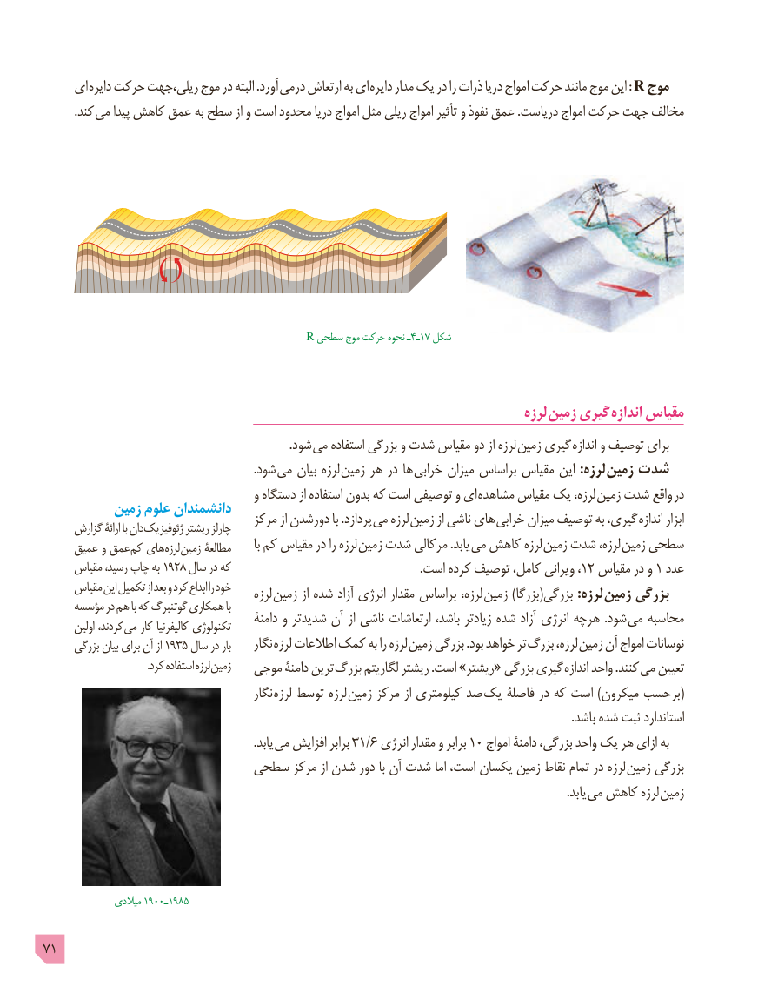

# PDF page 71

ای دایره حرکت ریلی،جهت موج در البته .آورد  درمی ارتعاش به ای دایره مدار یک در را ذرات دریا امواج حرکت مانند موج این : R موج
   . کند می پیدا کاهش عمق به سطح از و است محدود دریا امواج مثل ریلی امواج تأثیر و نفوذ عمق .دریاست امواج حرکت جهت مخالف

                                  R سطحی موج حرکت نحوه ـ4ـ17 شکل

                                                                                   لرزه زمین گیری اندازه مقیاس
                                                                                   .شود می استفاده بزرگی و شدت مقیاس دو از لرزه زمین گیری اندازه و توصیف برای
                                                                       .شود می بیان لرزه زمین هر در ها  خرابی میزان براساس مقیاس این :لرزه زمین شدت
                                      و دستگاه از استفاده بدون که است توصیفی و ای مشاهده مقیاس یک لرزه، زمین شدت واقع در
          زمین علوم دانشمندان                                    مرکز از دورشدن با .پردازد می لرزه  زمین از ناشی های  خرابی میزان توصیف به گیری، اندازه ابزار     گزارش ارائۀ با دان ژئوفیزیک ریشتر چارلز
     عمیق و عمق کم های لرزه زمین مطالعۀ       با کم مقیاس در را لرزه  زمین شدت مرکالی .یابد می کاهش لرزه  زمین شدت لرزه، زمین سطحی
     مقیاس رسید، چاپ به 1928 سال در که   .12است کرده توصیف کامل، ویرانی ،   مقیاس در و 1 عدد
     مقیاس این تکمیل از بعد و کرد ابداع را خود                                             لرزه  زمین از شده آزاد انرژی مقدار براساس لرزه،  زمین )بزرگا(بزرگی :لرزه زمین بزرگی     مؤسسه در هم با که گوتنبرگ همکاری با                                            دامنۀ و شدیدتر آن از ناشی ارتعاشات باشد، زیادتر شده آزاد انرژی هرچه  .شود می محاسبه       اولین کردند، می کار کالیفرنیا تکنولوژی
      بزرگی بیان برای آن از 1935 سال در بار     نگار  لرزه اطالعات کمک به را لرزه  زمین بزرگی .بود خواهد تر  بزرگ لرزه، زمین آن امواج نوسانات
   . کرد استفاده لرزه زمین   موجی دامنۀ ترین  بزرگ لگاریتم ریشتر .است »ریشتر« بزرگی گیری  اندازه واحد .کنند می تعیین
                                            نگار  لرزه توسط لرزه  زمین مرکز از کیلومتری صد  (یک فاصلۀ در که است )میکرون برحسب
                                                                                                                                                                                  .باشد شده ثبت استاندارد
                                                                       .یابد می افزایش برابر 31/6 انرژی مقدار و برابر 10 امواج دامنۀ بزرگی، واحد یک هر ازای به
                       سطحی مرکز از شدن دور با آن شدت اما است، یکسان زمین نقاط تمام در لرزه زمین بزرگی
                                            . یابد می کاهش لرزه زمین

                میالدی 1900ـ1985

71

