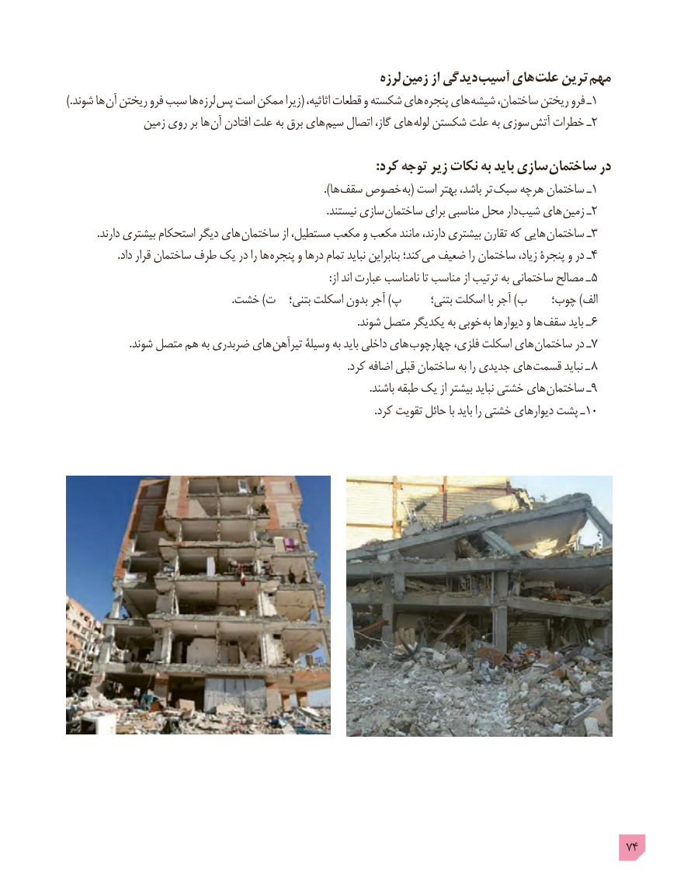

# PDF page 74

لرزه زمین از دیدگی آسیب های علت ترین مهم
.) شوند ها آن ریختن فرو سبب ها  لرزه  پس است ممکن زیرا( اثاثیه، قطعات و شکسته های پنجره های شیشه ساختمان، ریختن فرو ـ1
              زمین روی بر ها  آن افتادن علت به برق های  سیم اتصال گاز، های لوله شکستن علت به سوزی  آتش خطرات ـ2

                                                                                        :کرد توجه زیر نکات به باید سازی ساختمان در
                                         ). ها سقف خصوص به( است بهتر باشد، تر سبک هرچه ساختمان ـ1
                                                                                                  .نیستند سازی ساختمان برای مناسبی محل دار  شیب های زمین ـ2
            .دارند بیشتری استحکام دیگر های  ساختمان از مستطیل، مکعب و مکعب مانند دارند، بیشتری تقارن که هایی  ساختمان ـ3
                   .داد قرار ساختمان طرف یک در را ها  پنجره و درها تمام نباید بنابراین کند؛ می ضعیف را ساختمان زیاد، پنجرۀ و در ـ4
                                                                                                    :از اند عبارت نامناسب تا مناسب از ترتیب به ساختمانی مصالح ـ 5
                                                               .خشت )ت   بتنی؛ اسکلت بدون آجر )پ       بتنی؛ اسکلت با آجر )ب    چوب؛ )الف
     . شوند متصل یکدیگر به خوبی به دیوارها و ها  سقف باید ـ 6
                        .شوند متصل هم به ضربدری های  تیرآهن وسیلۀ به باید داخلی های  چهارچوب فلزی، اسکلت های 7ساختمان در ـ
                                                                                                          .کرد اضافه قبلی ساختمان به را جدیدی های قسمت نباید ـ 8
                                                                                                                   .باشند طبقه یک از بیشتر نباید خشتی های ساختمان ـ9
                                                                                                                     .کرد تقویت حائل با باید را خشتی دیوارهای پشت ـ10

                                                                                            74

