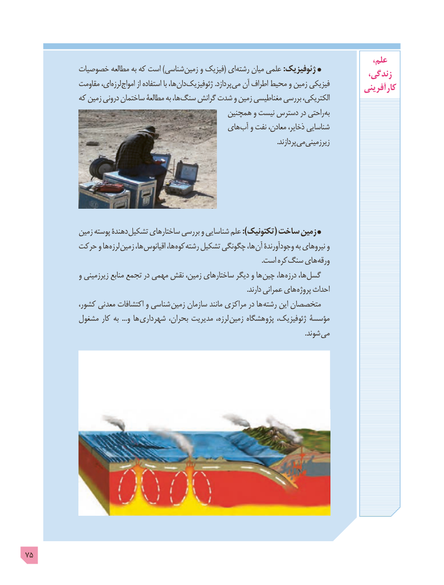

# PDF page 75

،علم
            خصوصیات مطالعه به که است )شناسی زمین و فیزیک( ای رشته میان علمی :ژئوفیزیک                                                                                       زندگی،
               مقاومت ای، لرزه امواج از استفاده با ها، دان ژئوفیزیک .پردازد می آن اطراف محیط و زمین فیزیکی                                                                                            آفرینی  کار
              که زمین درونی ساختمان مطالعۀ به ها، سنگ گرانش شدت و زمین مغناطیسی بررسی الکتریکی،
                                                   همچنین و نیست دسترس در راحتی به
                                                 های آب و نفت معادن، ذخایر، شناسایی
                       . پردازند میزیرزمینی

               زمین پوسته دهندۀ تشکیل ساختارهای بررسی و شناسایی علم ):تکتونیک( ساخت زمین
            حرکت و ها لرزه زمین ها، اقیانوس ها، کوه رشته تشکیل چگونگی ها، آن وجودآورندۀ به نیروهای و
                 . است کره سنگ های ورقه
                 و زیرزمینی منابع تجمع در مهمی نقش زمین، ساختارهای دیگر و ها چین ها، درزه ها، گسل
                                                                                                                                .دارند عمرانی های پروژه احداث
               کشور، معدنی اکتشافات و شناسی زمین سازمان مانند مراکزی در ها رشته این متخصصان
             مشغول کار به  ...و ها  شهرداری بحران، مدیریت لرزه، زمین پژوهشگاه ژئوفیزیک، مؤسسۀ
                                                                                                                                                                 .شوند می

75

