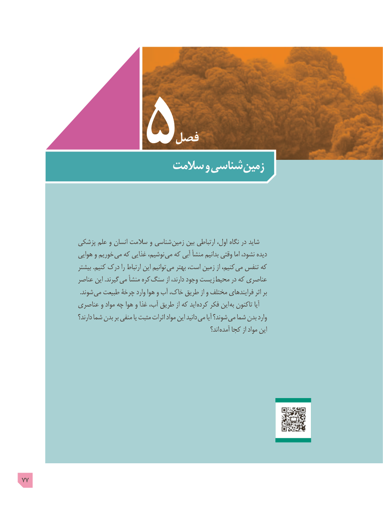

# PDF page 77

فصل
                        سالمت و شناسی زمین

                پزشکی علم و انسان سالمت و شناسی زمین بین ارتباطی اول، نگاه در شاید
                   هوایی و خوریم می که غذایی نوشیم، می که آبی منشأ بدانیم وقتی اما نشود، دیده
                     بیشتر .کنیم درک را ارتباط این توانیم می بهتر است، زمین از کنیم، می تنفس که
                  عناصر این .گیرند می منشأ کره سنگ از دارند، وجود زیست  محیط در که عناصری
        . شوند می طبیعت چرخۀ وارد هوا و آب خاک، طریق از و مختلف فرایندهای اثر بر
                عناصری و مواد چه هوا و غذا آب، طریق از که اید کرده فکر این  به تاکنون آیا
                        دارند؟ شما بدن بر منفی یا مثبت اثرات مواد این دانید می آیا شوند؟ می شما بدن وارد
                                                                                      اند؟ آمده کجا از مواد این

77

