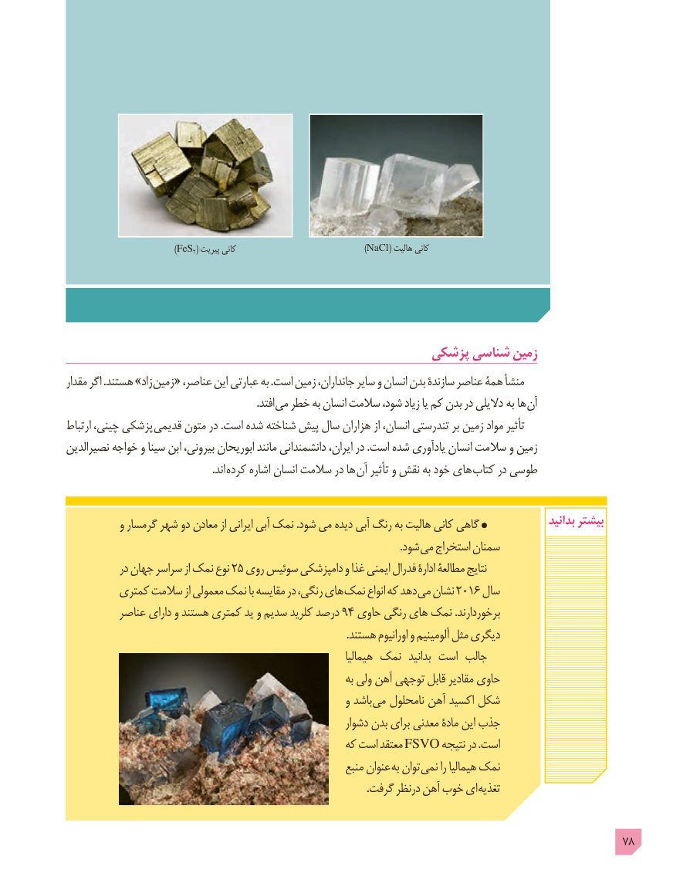

# PDF page 78

)FeS2( پیریت کانی                            )NaCl( هالیت کانی

                                                پزشکی شناسی زمین
مقدار اگر .هستند »زاد زمین « ،اینعناصر     عبارتی به .است زمین جانداران، سایر و انسان بدن سازندۀ عناصر همۀ منشأ
                  . افتد می خطر به انسان سالمت شود، زیاد یا کم بدن در دالیلی به ها آن
ارتباط چینی، پزشکی قدیمی متون در .است شده شناخته پیش سال هزاران از انسان، تندرستی بر زمین مواد تأثیر
نصیرالدین خواجه و سینا ابن بیرونی، ابوریحان مانند دانشمندانی ایران، در .است شده یادآوری انسان سالمت و زمین
                                                        .اند کرده اشاره انسان سالمت در ها آن تأثیر و نقش به خود های کتاب در طوسی

           و گرمسار شهر دو معادن از ایرانی آبی نمک .شود می دیده آبی رنگ به هالیت کانی گاهی                بدانید بیشتر
                                                                                                                               .شود می استخراج سمنان
            در جهان سراسر از نمک نوع 25 روی سوئیس دامپزشکی و غذا ایمنی فدرال ادارۀ مطالعۀ نتایج
         کمتری سالمت از معمولی نمک با مقایسه در رنگی، های نمک انواع که دهد می نشان 2016 سال
          عناصر دارای و هستند کمتری ید و سدیم کلرید درصد 94 حاوی رنگی های نمک .برخوردارند
                                                                                                           .هستند اورانیوم و آلومینیم مثل دیگری
                                                                      هیمالیا نمک  بدانید است جالب
                                                                  به ولی آهن توجهی قابل مقادیر حاوی
                                                          و باشد می نامحلول آهن اکسید شکل
                                                            دشوار بدن برای معدنی مادۀ این جذب
                                                 که است معتقد FSVO نتیجه در .است
                                                            منبع عنوان به توان نمی را هیمالیا نمک
     . گرفت درنظر آهن خوب ای تغذیه

                                                                                            78

