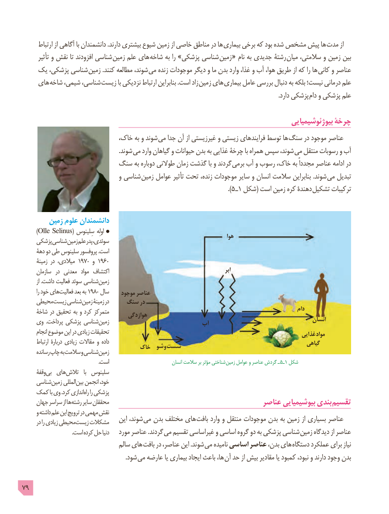

# PDF page 79

ارتباط از آگاهی با دانشمندان .دارند بیشتری شیوع زمین از خاصی مناطق در ها بیماری برخی که بود شده مشخص پیش ها مدت از
       تأثیر و نقش تا افزودند شناسی  زمین علم های شاخه به را »پزشکی شناسی  زمین « نام به جدیدی رشتۀ میان سالمتی، و زمین بین
   یک پزشکی، شناسی زمین .کنند مطالعه شوند، می زنده موجودات دیگر و ما بدن وارد غذا، و آب هوا، طریق از که را ها کانی و عناصر
    های شاخه شیمی، شناسی، زیست با نزدیکی ارتباط بنابراین .است زاد  زمین های بیماری عامل بررسی دنبال به بلکه نیست؛ درمانی علم
                . دارد پزشکی دام و پزشکی علم

                                                                                    بیوژئوشیمیایی چرخۀ
                           خاک، به و شوند می جدا آن از غیرزیستی و زیستی فرایندهای توسط ها سنگ در موجود عناصر
                                                                .شوند  می وارد گیاهان و حیوانات بدن به غذایی چرخۀ با همراه سپس شوند، می منتقل رسوبات و آب
                     سنگ به دوباره طوالنی زمان گذشت با و گردند برمی آب و رسوب خاک، به مجدداً عناصر ادامه در
                                  و شناسی زمین عوامل تأثیر تحت زنده، موجودات سایر و انسان سالمت بنابراین .شوند می تبدیل
                                                                                                                     ).٥ ـ١ شکل( است زمین کره دهندۀ  تشکیل ترکیبات

        زمین علوم دانشمندان
        )Olle Selinus( سِلینوس  اولِه                                                                                       هوا    پزشکی  شناسی زمین علم پدر ،سوئدی
     دهۀ دو طی سلینوس پروفسور .است
      زمینۀ در میالدی، 1970 و 1960
      سازمان  در معدنی  مواد اکتشاف                                                            ابر
         از .داشت فعالیت سوئد شناسی زمین
         را خود های فعالیت بعد به 1980 سال    موجود عناصر
    محیطی زیست شناسی زمین زمینۀ در    سنگ در
     شاخۀ در تحقیق به و کرد متمرکز                                                                          دام                                       هوازدگی
    وی  .پرداخت پزشکی شناسی زمین                            آب                                      انسان
      انجام موضوع این در زیادی تحقیقات                                                                                                   غذایی  مواد
       ارتباط دربارۀ زیادی مقاالت و داده                                                                        گیاهی                                 خاک  شو و شست      رسانده چاپ به سالمت و شناسی زمین
                                                        .است                              انسان سالمت بر مؤثر شناختی  زمین عوامل و عناصر گردش ـ 5ـ1 شکل
      وقفۀ بی های تالش   با  سلینوس
     شناسی زمین المللی بین انجمن خود،
   کمک با وی .کرد اندازی راه را پزشکی
     جهان سراسر از ها رشته سایر محققان                                          عناصر بیوشیمیایی بندی تقسیم
      و داشته علم این ترویج در مهمی نقش                                   این شوند، می بدن مختلف های بافت وارد و منتقل موجودات بدن به زمین از بسیاری عناصر      در را زیادی محیطی زیست مشکالت
                                     .است کرده حل دنیا   مورد عناصر .گردند می تقسیم غیراساسی و اساسی گروه دو به پزشکی شناسی زمین دیدگاه از عناصر
                                  سالم های بافت در عناصر، این .شوند می نامیده اساسی عناصر بدن، های دستگاه عملکرد برای نیاز
               . شود می عارضه یا بیماری ایجاد باعث ها، آن حد از بیش مقادیر یا کمبود نبود، و دارند وجود بدن

79

