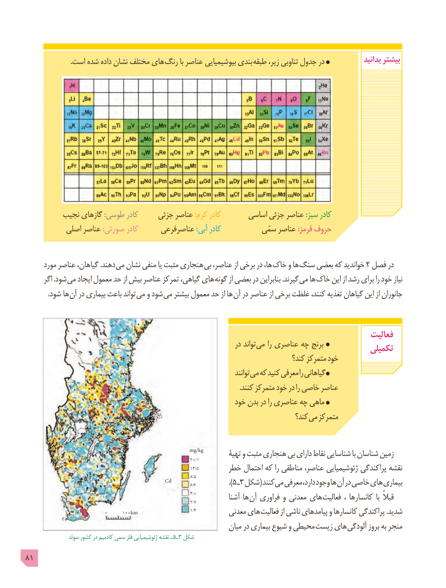

# PDF page 81

.است شده داده نشان مختلف های  رنگ با عناصر بیوشیمیایی بندی طبقه زیر، تناوبی جدول در             بدانید بیشتر

         نجیب گازهای :طوسی کادر     جزئی عناصر :کرم کادر       اساسی جزئی عناصر :سبز کادر
           اصلی عناصر :صورتی کادر      عناصرفرعی :آبی کادر           سمّی عناصر :قرمز حروف

      مورد عناصر گیاهان، .دهند می نشان منفی یا مثبت هنجاری بی عناصر، از برخی در ها، خاک و ها سنگ بعضی که خواندید 2 فصل در
      اگر .شود می ایجاد معمول حد از بیش عناصر تمرکز گیاهی، های گونه از بعضی در بنابراین .گیرند می ها خاک این از رشد برای را خود نیاز
   . شود ها آن در بیماری باعث تواند می و شود می بیشتر معمول حد از ها آن در عناصر از برخی غلظت کنند، تغذیه گیاهان این از جانوران

                                                                                           فعالیت                                                                     در تواند می را عناصری چه برنج                                                                                       تکمیلی
                                                                                  کند؟ متمرکز خود
                                                                                     توانند می که کنید معرفی را گیاهانی
                                                                                                                           .کنند متمرکز خود در را خاصی عناصر
                                                          خود بدن در را عناصری چه ماهی
                                                                                   کند؟ می متمرکز

                                                           mg/kg                                                                  تهیۀ و مثبت هنجاری بی دارای نقاط شناسایی با شناسان زمین                                                                         20/1
                                                                            13/5                                                خطر احتمال که را مناطقی عناصر، ژئوشیمیایی پراکندگی نقشه
                                                                                8/5
                                           Cd                                                                                   6/3                ).٥ ـ٣ شکل( کنند می معرفی دارد، وجود ها آن در خاصی های بیماری
                                                                           4/0                                                                                2/7            آشنا ها آن فراوری و معدنی های فعالیت  ، کانسارها  با قبالً
                                                                                1/4                           0     100km                          معدنی های فعالیت از ناشی پیامدهای و کانسارها پراکندگی .شدید
                                                              میان در بیماری شیوع و محیطی زیست های آلودگی بروز به منجر
                 سوئد کشور در کادمیم سمی فلز ژئوشیمیایی نقشه ـ  ٥ ـ٣ شکل
81

