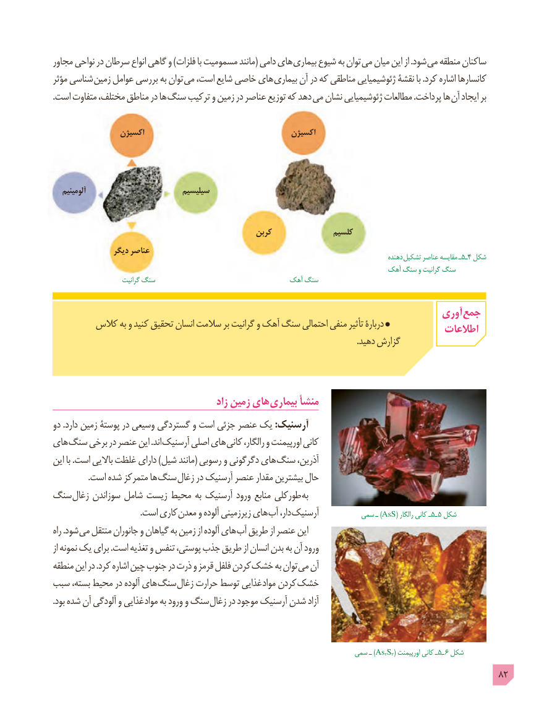

# PDF page 82

مجاور نواحی در سرطان انواع گاهی و )فلزات با مسمومیت مانند( دامی های بیماری شیوع به توان می میان این از .شود می منطقه ساکنان
مؤثر شناسی زمین عوامل بررسی به توان می است، شایع خاصی های بیماری آن در که مناطقی ژئوشیمیایی نقشۀ با .کرد اشاره کانسارها
. است متفاوت مختلف، مناطق در ها سنگ ترکیب و زمین در عناصر توزیع که دهد می نشان ژئوشیمیایی مطالعات .پرداخت ها آن ایجاد بر

                اکسیژن                                    اکسیژن

   آلومینیم                         سیلیسیم

                                                  کربن               کلسیم
                دیگر عناصر                                                                                                                دهنده تشکیل٥ـ٤عناصر مقایسه ـ   شکل
                                                                             آهک سنگ و گرانیت سنگ
                        گرانیت سنگ                               آهک سنگ

                                                                             آوری جمع        کالس به و کنید تحقیق انسان سالمت بر گرانیت و آهک سنگ احتمالی منفی تأثیر دربارۀ                                                                                 اطالعات
                                                                                                                                                 .دهید گزارش

                                           زاد زمین های بیماری منشأ
دو .دارد زمین پوستۀ در وسیعی گستردگی و است جزئی عنصر یک :آرسنیک
های سنگ برخی در عنصر این .اند آرسنیک اصلی های کانی رالگار، و اورپیمنت کانی
این با .است باالیی غلظت دارای )شیل مانند( رسوبی و دگرگونی های سنگ آذرین،
 . است شده متمرکز ها سنگ زغال در آرسنیک عنصر مقدار بیشترین حال
سنگ زغال سوزاندن شامل زیست محیط به آرسنیک ورود منابع طورکلی به
    . است کاری معدن و آلوده زیرزمینی های آب دار، آرسنیک          سمی ـ )AsS( رالگار٥ـکانی ـ    ٥ شکل
راه .شود می منتقل جانوران و گیاهان به زمین از آلوده های آب طریق از عنصر این
از نمونه یک برای .است تغذیه و تنفس پوستی، جذب طریق از انسان بدن به آن ورود
منطقه این در .کرد اشاره چین جنوب در ذرت و قرمز فلفل کردن خشک به توان می آن
سبب بسته، محیط در آلوده های سنگ زغال حرارت توسط غذایی مواد کردن خشک
. بود شده آن آلودگی و غذایی مواد به ورود و سنگ زغال در موجود آرسنیک شدن آزاد

                                                                     سمی ـ )As2S3( اورپیمنت٥ـکانی ـ    ٦ شکل
                                                                                            82

