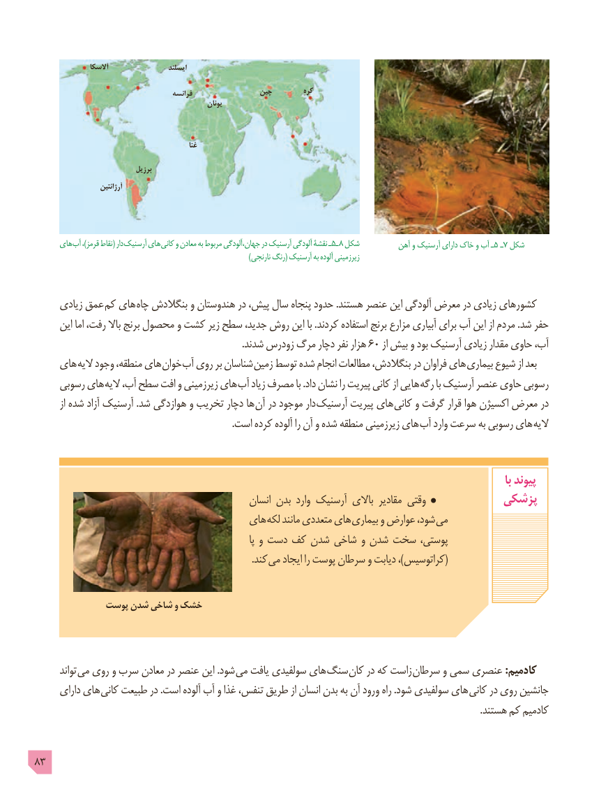

# PDF page 83

آالسکا                    ایسلند

                                          فرانسه                چین         کره
                                                        یونان

                                                        غنا

                                برزیل
                        آرژانتین

      های آب ،)قرمز نقاط( دار آرسنیک های کانی٥ـو معادن به مربوط جهان،آلودگی در آرسنیک آلودگی نقشۀ ـ    ٨ شکل  آهن٥و آرسنیک دارای خاک و آب ـ    ـ7 شکل
                                                                                            )نارنجی رنگ( آرسنیک به آلوده زیرزمینی

     زیادی عمق کم های چاه بنگالدش و هندوستان در پیش، سال پنجاه حدود .هستند عنصر این آلودگی معرض در زیادی کشورهای
      این اما رفت، باال برنج محصول و کشت زیر سطح جدید، روش این با .کردند استفاده برنج مزارع آبیاری برای آب این از مردم .شد حفر
    .60شدند زودرس مرگ دچار نفر هزار     از بیش و بود آرسنیک زیادی مقدار حاوی آب،
    های الیه وجود منطقه، های خوان آب روی بر شناسان زمین توسط شده انجام مطالعات بنگالدش، در فراوان های بیماری شیوع از بعد
     رسوبی های الیه آب، سطح افت و زیرزمینی های آب زیاد مصرف با .داد نشان را پیریت کانی از هایی رگه با آرسنیک عنصر حاوی رسوبی
        از شده آزاد آرسنیک .شد هوازدگی و تخریب دچار ها آن در موجود دار آرسنیک پیریت های کانی و گرفت قرار هوا اکسیژن معرض در
  . است کرده آلوده را آن و شده منطقه زیرزمینی های آب وارد سرعت به رسوبی های الیه

                                                                                                                                            با پیوند
                                                 انسان بدن وارد آرسنیک باالی مقادیر وقتی           پزشکی
                                     های لکه مانند متعددی های بیماری و عوارض شود، می
                                                                             پا و دست کف شدن شاخی و شدن سخت پوستی،
   . (کند می ایجاد را پوست سرطان و دیابت ،)کراتوسیس

             پوست شدن شاخی و خشک

       تواند می روی و سرب معادن در عنصر این .شود می یافت سولفیدی های سنگ کان در که زاست سرطان و سمی عنصری :کادمیم
      دارای های کانی طبیعت در .است آلوده آب و غذا تنفس، طریق از انسان بدن به آن ورود راه .شود سولفیدی های کانی در روی جانشین
                                                                                                                                                                                            .هستند کم کادمیم

83

