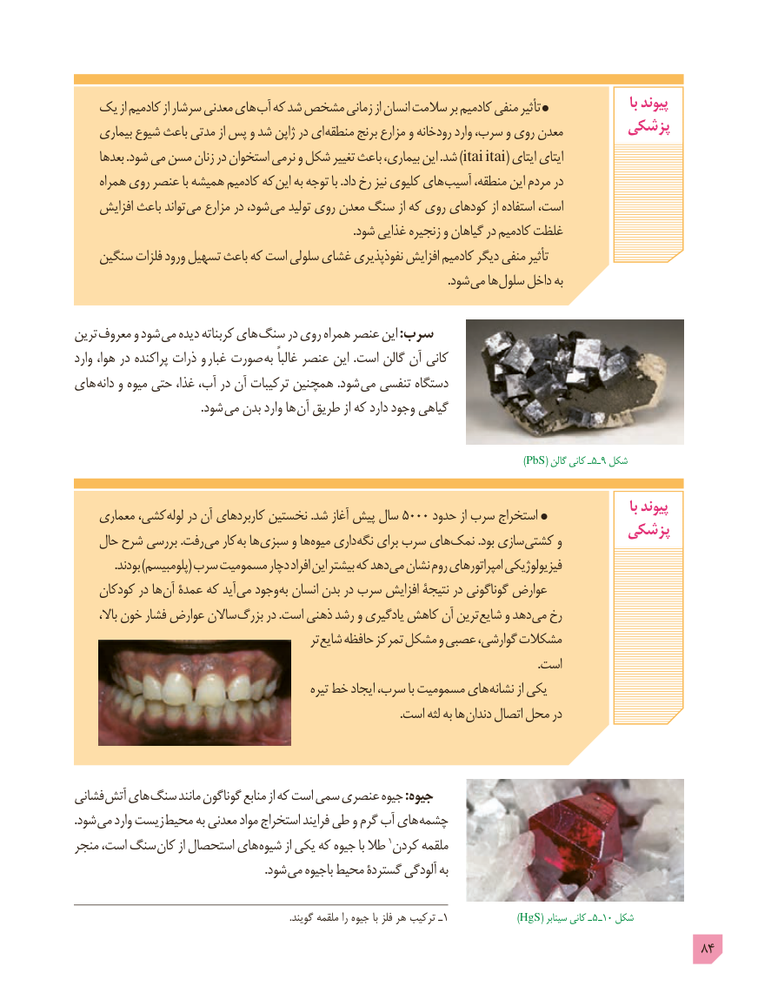

# PDF page 84

یک از کادمیم از سرشار معدنی های آب که شد مشخص زمانی از انسان سالمت بر کادمیم منفی تأثیر                     با پیوند
     بیماری شیوع باعث مدتی از پس و شد ژاپن در ای منطقه برنج مزارع و رودخانه وارد سرب، و روی معدن       پزشکی
     بعدها .شود می مسن زنان در استخوان نرمی و شکل تغییر باعث بیماری، این .شد ) itai itai( ایتای ایتای
     همراه روی عنصر با همیشه کادمیم که این به توجه با .داد رخ نیز کلیوی های آسیب منطقه، این مردم در
    افزایش باعث تواند می مزارع در شود، می تولید روی معدن سنگ از که روی کودهای از استفاده است،
                                                                                              .شود غذایی زنجیره و گیاهان در کادمیم غلظت
    سنگین فلزات ورود تسهیل باعث که است سلولی غشای نفوذپذیری افزایش کادمیم دیگر منفی تأثیر
                                                                                                                              .شود می ها سلول داخل به

ترین معروف و شود می دیده کربناته های  سنگ در روی همراه عنصر این :سرب
وارد هوا، در پراکنده ذرات و غبار صورت به غالباً عنصر این .است گالن آن کانی
های دانه و میوه حتی غذا، آب، در آن ترکیبات همچنین .شود  می تنفسی دستگاه
          . شود می بدن وارد ها آن طریق از که دارد وجود گیاهی

                                                                                           )PbS( گالن٥ـکانی ـ    9 شکل

                                                                                                                                    با پیوند    معماری کشی، لوله٥٠٠٠در آن کاربردهای نخستین .شد آغاز پیش سال      حدود از سرب استخراج
                                                                پزشکی    حال شرح بررسی .رفت می کار به ها سبزی و ها میوه داری نگه برای سرب های نمک .بود سازی کشتی و
              .بودند )پلومبیسم( سرب مسمومیت دچار افراد این بیشتر که دهد می نشان روم امپراتورهای فیزیولوژیکی
    کودکان در ها آن عمدۀ که آید می وجود به انسان بدن در سرب افزایش نتیجۀ در گوناگونی عوارض
       باال، خون فشار عوارض ساالن بزرگ در .است ذهنی رشد و یادگیری کاهش آن ترین شایع و دهد می رخ
                                                  تر شایع حافظه تمرکز مشکل و عصبی گوارشی، مشکالت
                                                                                                                                                             .است
                                                   تیره خط ایجاد سرب، با مسمومیت های نشانه از یکی
                                                                                                              .است لثه به ها دندان اتصال محل در

فشانی آتش های سنگ مانند گوناگون منابع از که است سمی عنصری جیوه :جیوه
.شود می وارد زیست محیط به معدنی مواد استخراج فرایند طی و گرم آب های چشمه
منجر است، سنگ کان از استحصال های شیوه از یکی که جیوه با طال 1کردن ملقمه
                                                                .شود می باجیوه محیط گستردۀ آلودگی به

                                                                                         .گویند ملقمه را جیوه با فلز هر ترکیب ـ1             )HgS( سینابر کانی ـ  ٥ ـ١0 شکل
                                                                                            84

