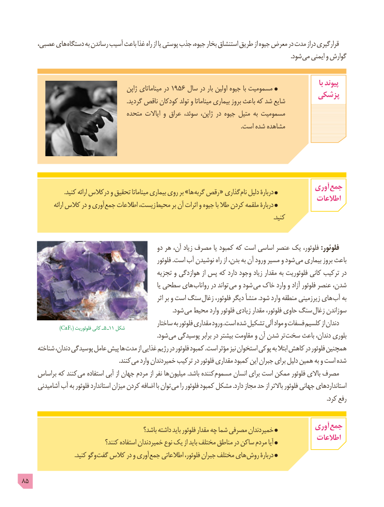

# PDF page 85

عصبی، های دستگاه به رساندن آسیب باعث غذا راه از یا پوستی جذب جیوه، بخار استنشاق طریق از جیوه معرض در مدت دراز قرارگیری
                                         . شود می ایمنی و گوارش

                                                                                                                                            با پیوند              ژاپن١٩٥٦میناماتای در     سال در بار اولین جیوه با مسمومیت                                                                    پزشکی                                                                      .گردید ناقص کودکان تولد و میناماتا بیماری بروز باعث که شد شایع
                                  متحده ایاالت و عراق سوئد، ژاپن، در جیوه متیل به مسمومیت
                                                                                                                                                  .است شده مشاهده

                                                                                 آوری جمع                            .کنید ارائه درکالس و تحقیق میناماتا بیماری روی بر »ها گربه رقص « گذاری نام دلیل دربارۀ                                                                                     اطالعات                 ارائه کالس در و آوری جمع اطالعات زیست، محیط بر آن اثرات و جیوه با طال کردن ملقمه دربارۀ
                                                                                                                                                                        .کنید

                                                 دو هر آن، زیاد مصرف یا کمبود که است اساسی عنصر یک فلوئور، :فلوئور
                                                          فلوئور .است آب نوشیدن راه از بدن، به آن ورود مسیر و شود می بیماری بروز باعث
                                              تجزیه و هوازدگی از پس که دارد وجود زیاد مقدار به فلوئوریت کانی ترکیب در
                                                                         یا سطحی های  رواناب در تواند می و شود می خاک وارد و آزاد فلوئور عنصر شدن،
                                                                    اثر بر و است سنگ  زغال فلوئور، دیگر منشأ .شود وارد منطقه زیرزمینی های آب به
                      . شود می محیط وارد فلوئور زیادی مقدار فلوئور، حاوی سنگ زغال سوزاندن
                                                    ساختار به فلوئور مقداری ورود .است شده تشکیل آلی مواد و فسفات کلسیم از دندان                )CaF2( فلوئوریت٥کانی ـ   ـ11 شکل
                                                                                          .شود می پوسیدگی برابر در بیشتر مقاومت و آن شدن تر سخت باعث دندان، بلوری
      شناخته دندان، پوسیدگی عامل پیش ها مدت از غذایی رژیم در فلوئور کمبود .است مؤثر نیز استخوان پوکی به ابتال کاهش در فلوئور همچنین
              . کنند می وارد خمیردندان ترکیب در فلوئور مقداری کمبود این جبران برای دلیل همین به و است شده
     براساس که کنند می استفاده آبی از جهان مردم از نفر ها میلیون .باشد کننده مسموم انسان برای است ممکن فلوئور باالی مصرف
      آشامیدنی آب به فلوئور استاندارد میزان کردن اضافه با توان می را فلوئور کمبود مشکل .دارد مجاز حد از باالتر فلوئور جهانی استانداردهای
                                                                                                                                                                                                           .کرد رفع

                                                                                 آوری جمع                                              باشد؟ داشته باید فلوئور مقدار چه شما مصرفی خمیردندان
                                                                                     اطالعات                               کنند؟ استفاده خمیردندان نوع یک از باید مختلف مناطق در ساکن مردم آیا
                                   .کنید وگو گفت کالس در و آوری جمع اطالعاتی فلوئور، جبران مختلف های روش دربارۀ

85

