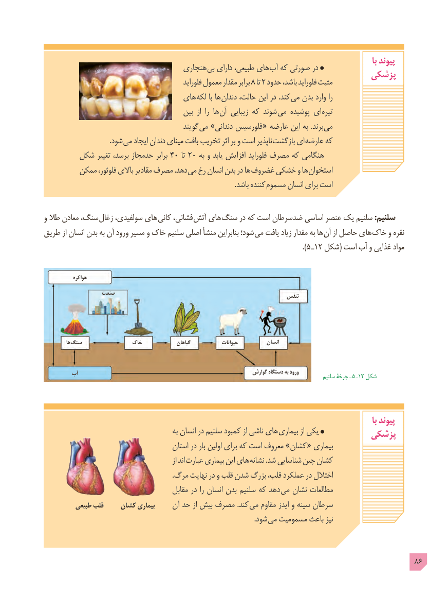

# PDF page 86

با پیوند                                    هنجاری بی دارای طبیعی، های آب که صورتی در                                                                پزشکی               فلوراید٨معمول مقدار برابر  تا٢ حدود باشد، فلوراید مثبت
                                 های لکه با ها دندان حالت، این در .کند می بدن وارد را
                                          بین  از  را ها آن زیبایی که شوند می پوشیده ای تیره
                                             گویند می »دندانی فلورسیس « عارضه این به .برند می
                                      .شود می ایجاد دندان مینای بافت تخریب اثر بر و است ناپذیر بازگشت ای عارضه که
       شکل تغییر برسد، حدمجاز برابر ٤٠ تا٢٠ به و یابد افزایش فلوراید مصرف که هنگامی
        ممکن فلوئور، باالی مقادیر مصرف .دهد می رخ انسان بدن در ها غضروف خشکی و ها استخوان
           . باشد کننده مسموم انسان برای است

و طال معادن سنگ، زغال سولفیدی، های کانی فشانی، آتش های سنگ در که است ضدسرطان اساسی عنصر یک سلنیم :سلنیم
طریق از انسان بدن به آن ورود مسیر و خاک سلنیم اصلی منشأ بنابراین شود؛ می یافت زیاد مقدار به ها آن از حاصل های خاک و نقره
                                                                                                                               ).٥ ـ١2 شکل( است آب و غذایی مواد

             هواکره

                 صنعت                                                                             تنفس

          ها سنگ                خاک               گیاهان             حیوانات           انسان

         آب                                                          گوارش دستگاه به ورود          سلنیم چرخۀ ـ  ٥ ـ١2 شکل

                                                                                                                                    با پیوند
                                              به انسان در سلنیم کمبود از ناشی های بیماری از یکی                                                                پزشکی
                                        استان در بار اولین برای که است معروف »کشان « بیماری
                                                           از اند  عبارت بیماری این های نشانه .شد شناسایی چین کشان
                                                                         .مرگ نهایت در و قلب شدن بزرگ قلب، عملکرد در اختالل
                                         مقابل در را انسان بدن سلنیم که دهد می نشان مطالعات
          طبیعی قلب    کشان بیماری     آن حد از بیش مصرف .کند  می مقاوم ایدز و سینه سرطان
                                                                                                                        .شود می مسمومیت باعث نیز

                                                                                            86

