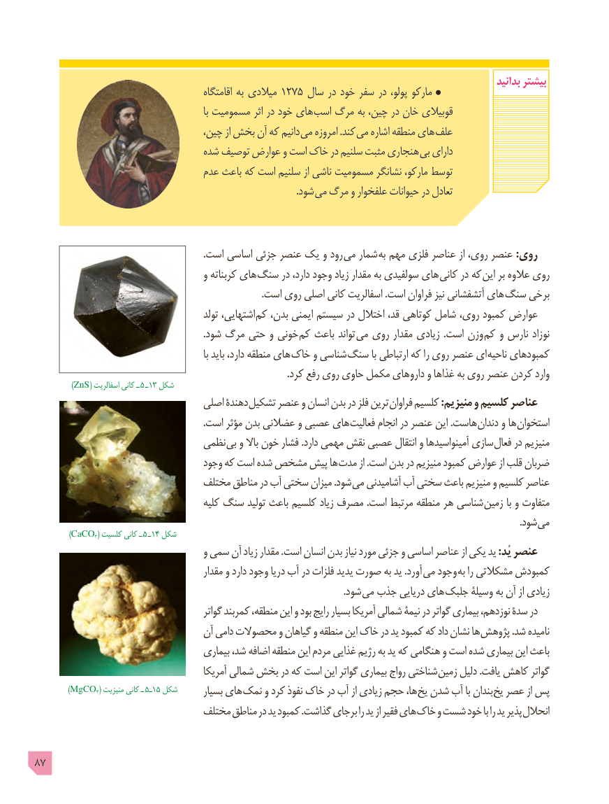

# PDF page 87

بدانید بیشتر                                               اقامتگاه به میالدی 1275 سال در خود سفر در پولو، مارکو
                                                                 با مسمومیت اثر در خود های اسب مرگ به چین، در خان قوبیالی
                                  چین، از بخش آن که دانیم می امروزه .کند می اشاره منطقه های علف
                                شده توصیف عوارض و است خاک در سلنیم مثبت هنجاری بی دارای
                                عدم باعث که است سلنیم از ناشی مسمومیت نشانگر مارکو، توسط
                                                                                                              .شود می مرگ و علفخوار حیوانات در تعادل

                                                                       .است اساسی جزئی عنصر یک و رود می شمار  به مهم فلزی عناصر از روی، عنصر :روی
                                      و کربناته های سنگ در دارد، وجود زیاد مقدار به سولفیدی های کانی در که این بر عالوه روی
                                                                                               .است روی اصلی کانی اسفالریت .است فراوان نیز آتشفشانی های سنگ برخی
                                             تولد اشتهایی، کم بدن، ایمنی سیستم در اختالل قد، کوتاهی شامل روی، کمبود عوارض
                                                                       .شود مرگ حتی و خونی کم باعث تواند می روی مقدار زیادی  .است وزن کم و نارس نوزاد
                                                                 با باید دارد، منطقه های خاک و شناسی سنگ با ارتباطی که را روی عنصر ای ناحیه کمبودهای
                                                                                                          .کرد رفع روی حاوی مکمل داروهای و غذاها به روی عنصر کردن وارد
         )ZnS( اسفالریت کانی ـ ٥ ـ١3 شکل
                                 اصلی دهندۀ تشکیل عنصر و انسان بدن در فلز ترین فراوان کلسیم :منیزیم و کلسیم عناصر
                                                                       .است مؤثر بدن عضالنی و عصبی های فعالیت انجام در عنصر این .هاست دندان و ها استخوان
                              نظمی بی و باال خون فشار .دارد مهمی نقش عصبی انتقال و آمینواسیدها سازی فعال در منیزیم
                                   وجود که است شده مشخص پیش ها مدت از .است بدن در منیزیم کمبود عوارض از قلب ضربان
                               مختلف مناطق در آب سختی میزان .شود می آشامیدنی آب سختی باعث منیزیم و کلسیم عناصر
                                         کلیه سنگ تولید باعث کلسیم زیاد مصرف .است مرتبط منطقه هر شناسی زمین با و متفاوت
                                                                                                                                                                                                            .شود می
        )CaCO3( کلسیت کانی ـ ٥ ـ١4 شکل
                                      و سمی آن زیاد مقدار .است انسان بدن نیاز مورد جزئی و اساسی عناصر از یکی ید :یُد عنصر
                                           مقدار و دارد وجود دریا آب در فلزات یدید صورت به ید .آورد می وجود به را مشکالتی کمبودش
                                                                                                                                  .شود می جذب دریایی های جلبک وسیلۀ به آن از زیادی
                                             گواتر کمربند منطقه، این و بود رایج بسیار آمریکا شمالی نیمۀ در گواتر بیماری نوزدهم، سدۀ در
                                  آن دامی محصوالت و گیاهان و منطقه این خاک در ید کمبود که داد نشان ها پژوهش .شد نامیده
                                      بیماری شد، اضافه منطقه این مردم غذایی رژیم به ید که هنگامی و است شده بیماری این باعث
                                           آمریکا شمالی بخش در که است این گواتر بیماری رواج شناختی زمین دلیل .یافت کاهش گواتر
       )MgCO3( منیزیت کانی ـ  ٥ـ١5 شکل       بسیار های نمک و کرد نفوذ خاک در آب از زیادی حجم ها، یخ شدن آب با بندان یخ عصر از پس
                               مختلف مناطق در ید کمبود .گذاشت برجای را ید از فقیر های خاک و شست خود با را ید پذیر انحالل

87

