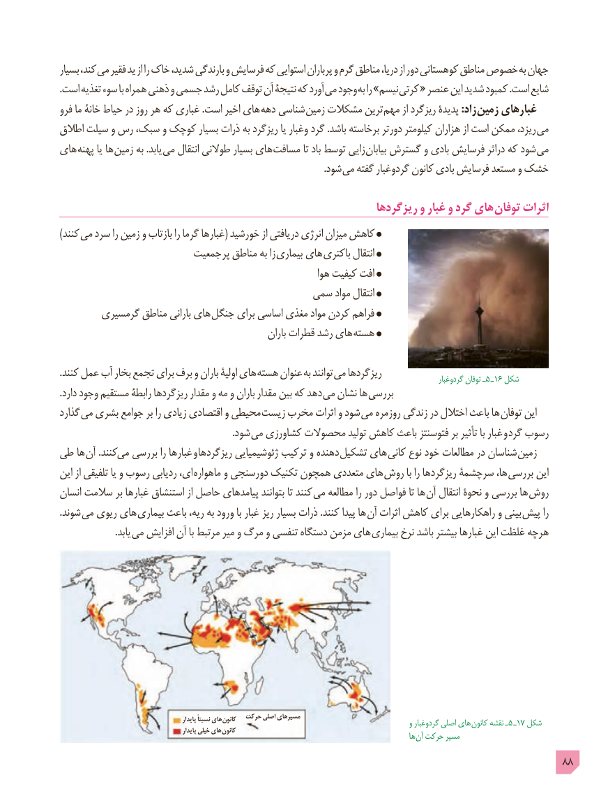

# PDF page 88

بسیار کند، می فقیر ید از را خاک شدید، بارندگی و فرسایش که استوایی پرباران و گرم مناطق دریا، از دور کوهستانی مناطق خصوص به جهان
.است تغذیه سوء با همراه ذهنی و جسمی رشد کامل توقف آن نتیجۀ که آورد می وجود به را »نیسم کرتی « عنصر این شدید کمبود .است شایع
فرو ما خانۀ حیاط در روز هر که غباری .است اخیر های دهه شناسی زمین مشکالت ترین مهم از ریزگرد پدیدۀ :زاد زمین غبارهای
اطالق سیلت و رس سبک، و کوچک بسیار ذرات به ریزگرد یا وغبار گرد .باشد برخاسته دورتر کیلومتر هزاران از است ممکن ریزد، می
های پهنه یا ها زمین به .یابد می انتقال طوالنی بسیار های مسافت تا باد توسط زایی بیابان گسترش و بادی فرسایش دراثر که شود می
                                                                                                               .شود می گفته گردوغبار کانون بادی فرسایش مستعد و خشک

                                                             ریزگردها و غبار و گرد های توفان اثرات
) کنند می سرد را زمین و بازتاب را گرما غبارها( خورشید از دریافتی انرژی میزان کاهش
                        جمعیت پر مناطق به زا بیماری های باکتری انتقال
                                                               هوا کیفیت افت
                                                                                سمی مواد انتقال
        گرمسیری مناطق بارانی های جنگل برای اساسی مغذی مواد کردن فراهم
                                                        باران قطرات رشد های هسته

.کنند عمل آب بخار تجمع برای برف و باران اولیۀ های  هسته عنوان به توانند می ریزگردها                                                                  گردوغبار٥توفان ـ   ـ١6 شکل
.دارد وجود مستقیم رابطۀ ریزگردها مقدار و مه و باران مقدار بین که دهد می نشان ها بررسی
گذارد  می بشری جوامع بر را زیادی اقتصادی و محیطی زیست مخرب اثرات و شود می روزمره زندگی در اختالل باعث ها توفان این
                                                                         .شود می کشاورزی محصوالت تولید کاهش باعث فتوسنتز بر تأثیر با غبار و گرد رسوب
طی ها آن .کنندمی   بررسی را غبارها  و  ریزگردها ژئوشیمیایی ترکیب و دهنده تشکیل های کانی نوع خود مطالعات در شناسان زمین
این از تلفیقی یا و رسوب ردیابی ای،  ماهواره و دورسنجی تکنیک همچون متعددی های روش با را ریزگردها سرچشمۀ ها، بررسی این
انسان سالمت بر غبارها استنشاق از حاصل پیامدهای بتوانند تا کنند می مطالعه را دور فواصل تا ها آن انتقال نحوۀ و بررسی ها روش
.شوند می ریوی های بیماری باعث ریه، به ورود با غبار ریز بسیار ذرات .کنند پیدا ها آن اثرات کاهش برای راهکارهایی و بینی پیش را
      . یابد می افزایش آن با مرتبط میر و مرگ و تنفسی دستگاه مزمن های  بیماری نرخ باشد بیشتر غبارها این غلظت هرچه

                                                     پایدار نسبتاً های  کانون  حرکت اصلی مسیرهای                                 و گردوغبار اصلی های  کانون٥نقشه ـ   ـ١7 شکل
                                                     پایدار خیلی های کانون                                                        ها آن حرکت مسیر
                                                                                            88

