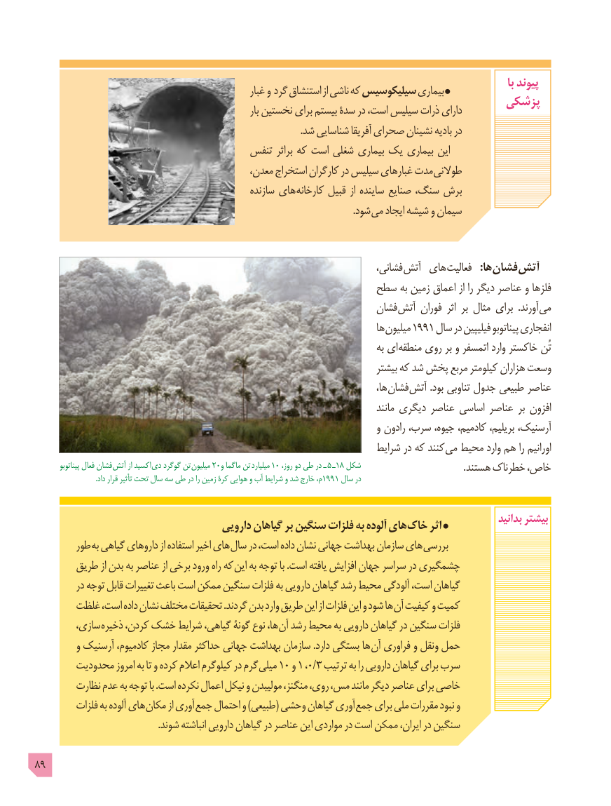

# PDF page 89

با پیوند                                                         غبار و گرد استنشاق از ناشی که سیلیکوسیس بیماری
                                                                    پزشکی                                                                       بار نخستین برای بیستم سدۀ در است، سیلیس ذرات دارای
                                                                                                               .شد شناسایی آفریقا صحرای نشینان بادیه در
                                      تنفس براثر که است شغلی بیماری یک بیماری این
                                              معدن، استخراج کارگران در سیلیس غبارهای مدت طوالنی
                                                    سازنده های کارخانه قبیل از ساینده صنایع سنگ، برش
                                                                                                                                     .شود می ایجاد شیشه و سیمان

                                                                             ،فشانی آتش های فعالیت   :ها فشان آتش
                                                  سطح به زمین اعماق از را دیگر عناصر و فلزها
                                                                 فشان آتش فوران  اثر بر مثال برای  .آورند می
                                                                                 ها میلیون 1991 سال در فیلیپین پیناتوبو انفجاری
                                                                                         به ای منطقه روی بر و اتمسفر وارد خاکستر تُن
                                                                                 بیشتر که شد پخش مربع کیلومتر هزاران وسعت
                                                                                              ها، فشان آتش .بود تناوبی جدول طبیعی عناصر
                                                                                               مانند دیگری عناصر اساسی عناصر بر افزون
                                                                              و رادون سرب، جیوه، کادمیم، بریلیم، آرسنیک،
                                                                      شرایط در که کنند می محیط وارد هم را اورانیم
          پیناتوبو فعال فشان  آتش از اکسید  دی گوگرد تن میلیون 20و ماگما تن  میلیارد 10 ،ـروز دو طی در   5 ـ18 شکل                                           . هستند خطرناک خاص،
                                  .داد قرار تأثیر تحت سال سه طی در را زمین کرۀ هوایی و آب شرایط و شد خارج م،1991 سال در

                                                                                                                    بدانید بیشتر                                      دارویی گیاهان بر سنگین فلزات به آلوده های خاک اثر
        طور به گیاهی داروهای از استفاده اخیر های سال در است، داده نشان جهانی بهداشت سازمان های بررسی
       طریق از بدن به عناصر از برخی ورود راه که این به توجه با .است یافته افزایش جهان سراسر در چشمگیری
          در توجه قابل تغییرات باعث است ممکن سنگین فلزات به دارویی گیاهان رشد محیط آلودگی است، گیاهان
       غلظت است، داده نشان مختلف تحقیقات .گردند بدن وارد طریق این از فلزات این و شود ها آن کیفیت و کمیت
        سازی، ذخیره کردن، خشک شرایط گیاهی، گونۀ نوع ها، آن رشد محیط به دارویی گیاهان در سنگین فلزات
         و آرسنیک کادمیوم، مجاز مقدار حداکثر جهانی بهداشت سازمان .دارد بستگی ها آن فراوری و ونقل حمل
       محدودیت امروز به تا و کرده اعالم کیلوگرم در گرم میلی 10 و 1 ،0/3 ترتیب به را دارویی گیاهان برای سرب
        نظارت عدم به توجه با .است نکرده اعمال نیکل و مولیبدن منگنز، روی، مس، مانند دیگر عناصر برای خاصی
         فلزات به آلوده های مکان از آوری جمع احتمال و )طبیعی( وحشی گیاهان آوری جمع برای ملی مقررات نبود و
                                                    .شوند انباشته دارویی گیاهان در عناصر این مواردی در است ممکن ایران، در سنگین

89

