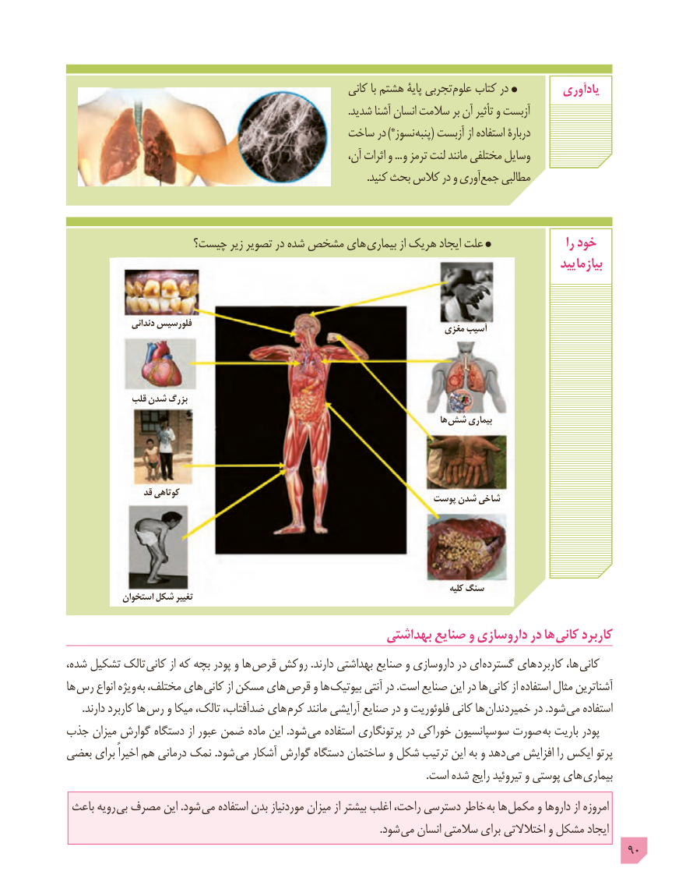

# PDF page 90

کانی با هشتم پایۀ تجربی علوم کتاب در          یادآوری
                                                                                                              .شدید آشنا انسان سالمت بر آن تأثیر و آزبست
                                          ساخت در *)نسوز پنبه( آزبست از استفاده دربارۀ
                                                              آن، اثرات و ... و ترمز لنت مانند مختلفی وسایل
     .‌کنید بحث کالس در و آوریجمع مطالبی

                   چیست؟ زیر تصویر در شده مشخص های بیماری از هریک ایجاد علت                   را خود
                                                                                                         بیازمایید

                 دندانی فلورسیس                                                                            مغزی آسیب

              قلب شدن بزرگ
                                                                                                     ها شش بیماری

                  قد کوتاهی                                                                پوست شدن شاخی

                                                                                                             کلیه سنگ            استخوان شکل تغییر

                                                 بهداشتی صنایع و داروسازی در ها کانی کاربرد
شده، تشکیل تالک کانی از که بچه پودر و ها قرص روکش .دارند بهداشتی صنایع و داروسازی در ای گسترده های  کاربرد ها، کانی
ها رس انواع ویژه  به مختلف، های کانی از مسکن های قرص و ها بیوتیک آنتی در .است صنایع این در ها کانی از استفاده مثال آشناترین
      .دارند کاربرد ها رس و میکا تالک، ضدآفتاب، های  کرم مانند آرایشی صنایع در و فلوئوریت کانی ها خمیردندان در .شود می استفاده
جذب میزان گوارش دستگاه از عبور ضمن ماده این .شود  می استفاده پرتونگاری در خوراکی سوسپانسیون صورت به باریت پودر
بعضی برای اخیراً هم درمانی نمک .شود می آشکار گوارش دستگاه ساختمان و شکل ترتیب این به و دهد می افزایش را ایکس پرتو
     . است شده رایج تیروئید و پوستی های بیماری
 باعث رویه  بی مصرف این .شود می استفاده بدن موردنیاز میزان از بیشتر اغلب راحت، دسترسی خاطر به ها مکمل و داروها از امروزه
                          . شود می انسان سالمتی برای اختالالتی و مشکل ایجاد
                                                                                             90

