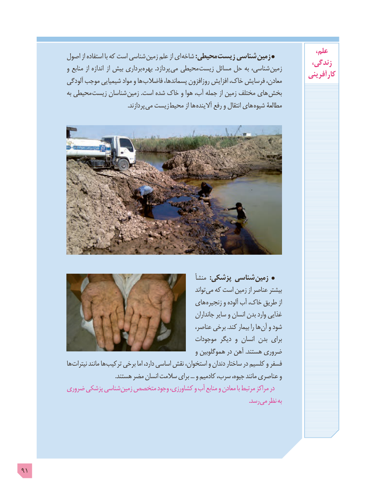

# PDF page 91

،علم             اصول از استفاده با که است شناسی زمین علم از ای شاخه :محیطی زیست شناسی زمین                                                                                       زندگی،                 و منابع از اندازه   از بیش برداری  بهره  .پردازد می محیطی زیست مسائل حل به شناسی، زمین                                                                                            آفرینی  کار                آلودگی موجب شیمیایی مواد و ها فاضالب پسماندها، روزافزون افزایش خاک، فرسایش معادن،
                   به محیطی زیست شناسان  زمین .است شده خاک و هوا آب، جمله از زمین مختلف های بخش
                                                                        .پردازند  می زیست  محیط از ها آالینده رفع و انتقال های شیوه مطالعۀ

                                                              منشأ  :پزشکی شناسی زمین
                                                                                   تواند می که است زمین از عناصر بیشتر
                                                 های زنجیره و آلوده آب خاک، طریق از
                                                                         جانداران سایر و انسان بدن وارد غذایی
                                                               عناصر، برخی .کند بیمار را ها آن و شود
                                                         موجودات دیگر و انسان بدن برای
                                                                و هموگلوبین در آهن .هستند ضروری
                 ها نیترات مانند ها ترکیب برخی اما دارد، اساسی نقش استخوان، و دندان ساختار در کلسیم و فسفر
                                                                .هستند مضر انسان سالمت برای ... و کادمیم سرب، جیوه، مانند عناصری و
            ضروری پزشکی شناسی زمین متخصص وجود کشاورزی، و آب منابع و معادن با مرتبط مراکز در
                                    . رسد می نظر به

91

