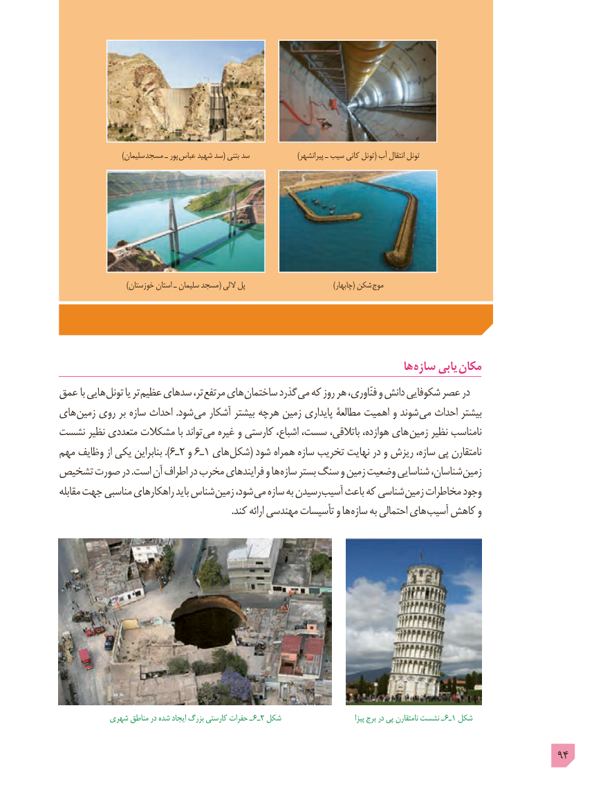

# PDF page 94

)سلیمان مسجد ـ پور عباس شهید سد( بتنی سد                     )پیرانشهر ـ سیب کانی تونل( آب انتقال تونل

                             )خوزستان استان ـ سلیمان مسجد( اللی پل    ) چابهار( شکن موج

                                                                        ها سازه یابی مکان
عمق با هایی تونل یا تر عظیم سدهای تر، مرتفع های ساختمان گذرد می که روز هر فنّاوری، و دانش شکوفایی عصر در
های زمین روی بر سازه احداث .شود می آشکار بیشتر هرچه زمین پایداری مطالعۀ اهمیت و شوند می احداث بیشتر
نشست نظیر متعددی مشکالت با تواند می غیره و کارستی اشباع، سست، باتالقی، هوازده، های زمین نظیر نامناسب
مهم وظایف از یکی بنابراین ). 6ـ2 و 6ـ1 های شکل( شود همراه سازه تخریب نهایت در و ریزش سازه، پی نامتقارن
تشخیص صورت در .است آن اطراف در مخرب فرایندهای و ها سازه بستر سنگ و زمین وضعیت شناسایی شناسان، زمین
مقابله جهت مناسبی راهکارهای باید شناس زمین شود، می سازه به رسیدن آسیب باعث که شناسی زمین مخاطرات وجود
                                                                         .کند ارائه مهندسی تأسیسات و ها سازه به احتمالی های آسیب کاهش و

           شهری مناطق در شده ایجاد بزرگ کارستی حفرات ـ 6ـ2 شکل                               پیزا برج در پی نامتقارن نشست ـ  6ـ1 شکل

                                                                                            94

