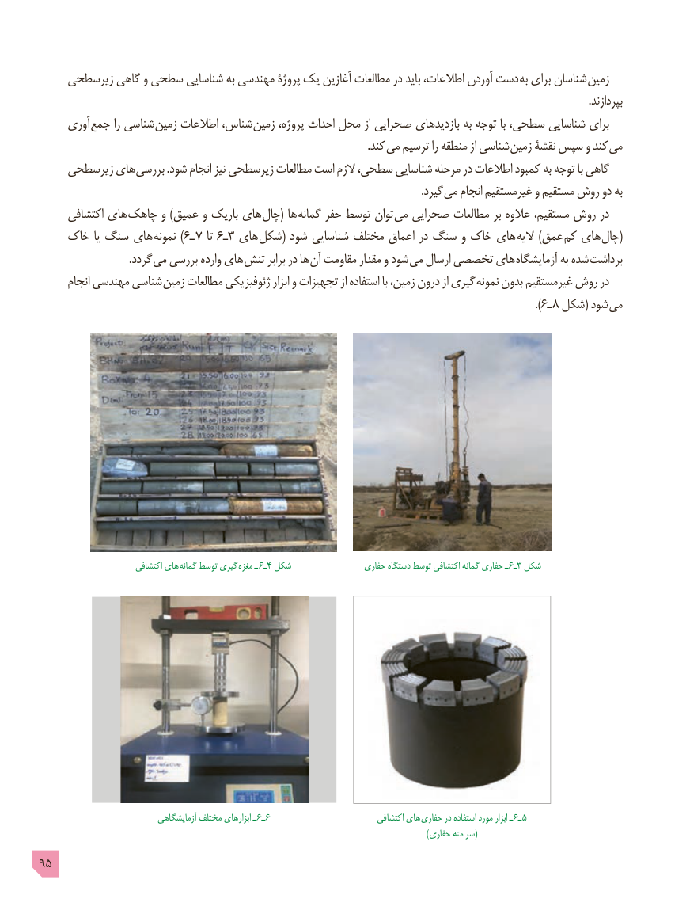

# PDF page 95

زیرسطحی گاهی و سطحی شناسایی به مهندسی پروژۀ یک آغازین مطالعات در باید اطالعات، آوردن دست به برای شناسان زمین
                                                                                                                                                                                                            .بپردازند
     آوری جمع را شناسی زمین اطالعات شناس، زمین پروژه، احداث محل از صحرایی بازدیدهای به توجه با سطحی، شناسایی برای
                              . کند می ترسیم را منطقه از شناسی زمین نقشۀ سپس و کند می
    زیرسطحی های بررسی .شود انجام نیز زیرسطحی مطالعات است الزم سطحی، شناسایی مرحله در اطالعات کمبود به توجه با گاهی
                              . گیرد می انجام غیرمستقیم و مستقیم روش دو به
     اکتشافی های چاهک و )عمیق و باریک های چال( ها گمانه حفر توسط توان می صحرایی مطالعات بر عالوه مستقیم، روش در
    خاک یا سنگ های )نمونه 6ـ 7 تا 6ـ3 های شکل( شود شناسایی مختلف اعماق در سنگ و خاک های الیه )عمق کم های (چال
       . گردد می بررسی وارده های تنش برابر در ها آن مقاومت مقدار و شود می ارسال تخصصی های آزمایشگاه به شده برداشت
      انجام مهندسی شناسی زمین مطالعات ژئوفیزیکی ابزار و تجهیزات از استفاده با زمین، درون از گیری نمونه بدون غیرمستقیم روش در
                                                                                                                                                                 ).٦ـ ٨ شکل( شود می

                         اکتشافی های گمانه توسط گیری  مغزه ـ  6ـ4 شکل                 حفاری دستگاه توسط اکتشافی گمانه حفاری ـ  6ـ3 شکل

                              آزمایشگاهی مختلف ابزارهای ـ 6ـ 6                            اکتشافی های حفاری در استفاده مورد ابزار ـ 6ـ 5
               )(حفاری مته سر
95

