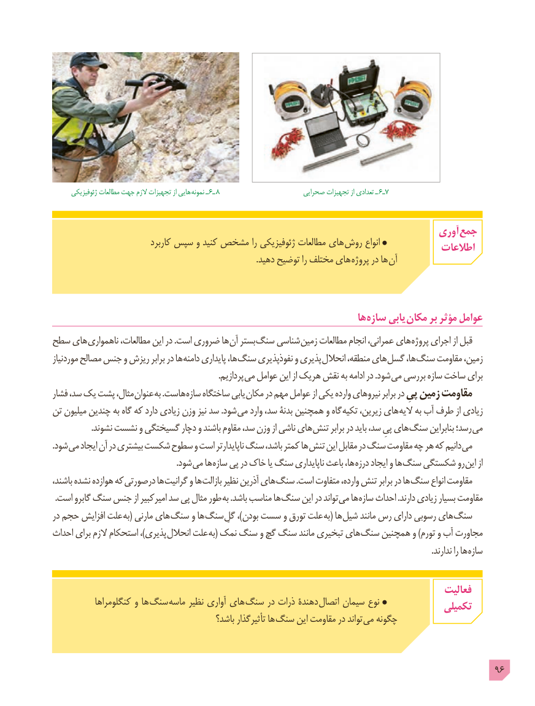

# PDF page 96

ژئوفیزیکی مطالعات جهت الزم تجهیزات از هایی نمونه ـ 6ـ 8                       صحرایی تجهیزات از تعدادی ـ 6ـ7

                                                                             آوری جمع
                             کاربرد سپس و کنید مشخص را ژئوفیزیکی مطالعات های روش انواع                                                                                 اطالعات
                                                                                                  .دهید توضیح را مختلف های پروژه در ها  آن

                                                                        ها سازه یابی مکان بر مؤثر عوامل
سطح های ناهمواری مطالعات، این در .است ضروری ها آن بستر سنگ شناسی زمین مطالعات انجام عمرانی، های پروژه اجرای از قبل
موردنیاز مصالح جنس و ریزش برابر در ها دامنه پایداری ها، سنگ نفوذپذیری و پذیری انحالل منطقه، های گسل ها، سنگ مقاومت زمین،
            . پردازیم می عوامل این از هریک نقش به ادامه در .شود می بررسی سازه ساخت برای
فشار سد، یک پشت مثال، عنوان به .هاست سازه ساختگاه یابی مکان در مهم عوامل از یکی وارده نیروهای برابر در پیِ زمین مقاومت
تن میلیون چندین به گاه که دارد زیادی وزن نیز سد .شود می وارد سد، بدنۀ همچنین و گاه تکیه زیرین، های الیه به آب طرف از زیادی
. نشوند نشست و گسیختگی دچار و باشند مقاوم سد، وزن از ناشی های تنش برابر در باید سد، پیِ های سنگ بنابراین رسد؛ می
.شود می ایجاد آن در بیشتری شکست سطوح و است ناپایدارتر سنگ باشد، کمتر ها تنش این مقابل در سنگ مقاومت چه هر که دانیم می
              . شود می ها سازه پی در خاک یا سنگ ناپایداری باعث ها، درزه ایجاد و ها سنگ شکستگی رو این از
باشند، نشده هوازده که درصورتی ها گرانیت و ها بازالت نظیر آذرین های سنگ .است متفاوت وارده، تنش برابر در ها سنگ انواع مقاومت
. است گابرو سنگ جنس از امیرکبیر سد پی مثال طور به .باشد مناسب ها سنگ این در تواند می ها سازه احداث .دارند زیادی بسیار مقاومت
در حجم افزایش علت به( مارنی های سنگ و ها سنگ گلِعلت،)بودن سست و تورق       به( ها شیل مانند رس دارای رسوبی های سنگ
احداث برای الزم استحکام ،)پذیری انحالل علت به( نمک سنگ و گچ سنگ مانند تبخیری های سنگ همچنین و )تورم و آب مجاورت
                                                                                                                                                                                      .ندارند را ها سازه

                                                                                      فعالیت
            کنگلومراها و ها  سنگ ماسه نظیر آواری های سنگ در ذرات دهندۀ اتصال سیمان نوع                                                                                  تکمیلی
                                            باشد؟ تأثیرگذار ها سنگ این مقاومت در تواند می چگونه

                                                                                            96

