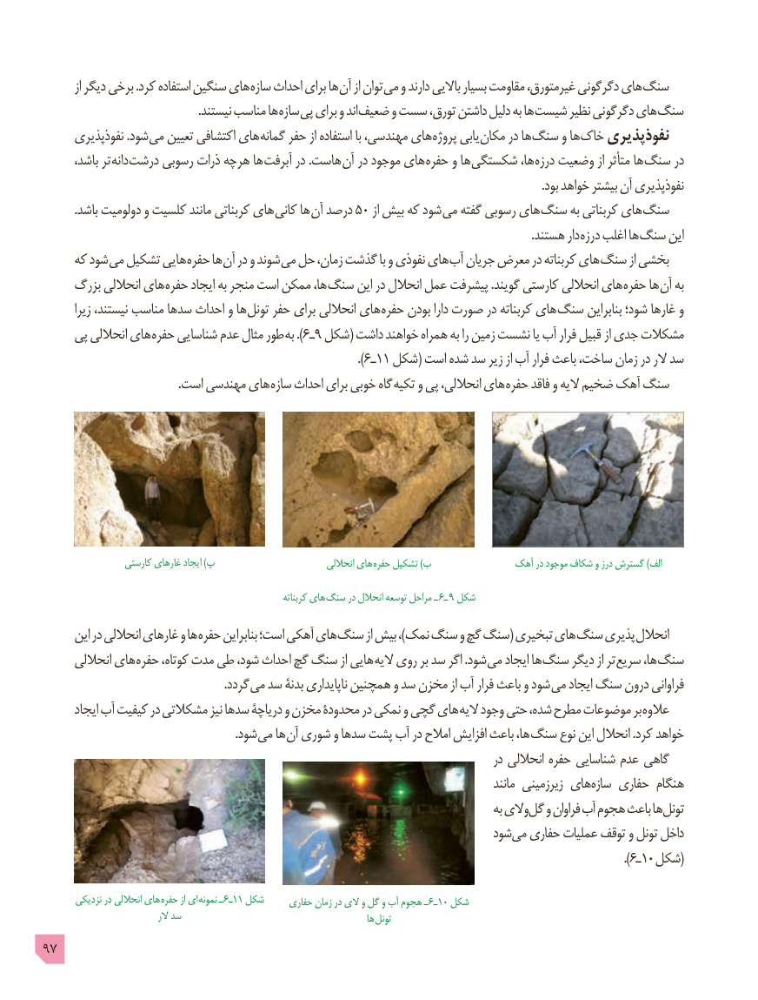

# PDF page 97

از دیگر برخی .کرد استفاده سنگین های سازه احداث برای ها آن از توان می و دارند باالیی بسیار مقاومت غیرمتورق، دگرگونی های سنگ
    . نیستند مناسب ها سازه پی برای و اند ضعیف و سست تورق، داشتن دلیل به ها شیست نظیر دگرگونی های سنگ
      نفوذپذیری .شود می تعیین اکتشافی های گمانه حفر از استفاده با مهندسی، های پروژه یابی مکان در ها سنگ و ها خاک نفوذپذیری
      باشد، تر دانه درشت رسوبی ذرات هرچه ها آبرفت در .هاست آن در موجود های حفره و ها شکستگی ها، درزه وضعیت از متأثر ها سنگ در
                                                                                                                                                                        .بود خواهد بیشتر آن نفوذپذیری
          .باشد دولومیت و کلسیت مانند کربناتی های کانی ها آن درصد 50 از بیش که شود می گفته رسوبی های سنگ به کربناتی های سنگ
                   . هستند دار درزه اغلب ها سنگ این
     که شود می تشکیل هایی حفره ها آن در و شوند می حل زمان، گذشت با و نفوذی های آب جریان معرض در کربناته های سنگ از بخشی
     بزرگ انحاللی های حفره ایجاد به منجر است ممکن ها، سنگ این در انحالل عمل پیشرفت .گویند کارستی انحاللی های حفره ها آن به
       زیرا نیستند، مناسب سدها احداث و ها تونل حفر برای انحاللی های حفره بودن دارا صورت در کربناته های سنگ بنابراین شود؛ غارها و
     پی انحاللی های حفره شناسایی عدم مثال طور ).به 6ـ9 شکل( داشت خواهند همراه به را زمین نشست یا آب فرار قبیل از جدی مشکالت
                                                                                              ).٦ـ١١ شکل( است شده سد زیر از آب فرار باعث ساخت، زمان در الر سد
                                              .است مهندسی های سازه احداث برای خوبی گاه تکیه و پی انحاللی، های حفره فاقد و الیه ضخیم آهک سنگ

                  کارستی غارهای ایجاد )پ                            انحاللی های  حفره تشکیل )ب              آهک در موجود شکاف و درز گسترش )الف

                                                                     کربناته های سنگ در انحالل توسعه مراحل ـ  6ـ 9 شکل
      این در انحاللی غارهای و ها حفره بنابراین است؛ آهکی های سنگ از بیش ،)نمک سنگ و گچ سنگ( تبخیری های سنگ پذیری انحالل
      انحاللی های حفره کوتاه، مدت طی شود، احداث گچ سنگ از هایی الیه روی بر سد اگر .شود می ایجاد ها سنگ دیگر از تر سریع ها، سنگ
            . گردد می سد بدنۀ ناپایداری همچنین و سد مخزن از آب فرار باعث و شود می ایجاد سنگ درون فراوانی
      ایجاد آب کیفیت در مشکالتی نیز سدها دریاچۀ و مخزن محدودۀ در نمکی و گچی های الیه وجود حتی شده، مطرح موضوعات بر عالوه
               . شود می ها آن شوری و سدها پشت آب در امالح افزایش باعث ها، سنگ نوع این انحالل .کرد خواهد
                                                                                           در انحاللی حفره شناسایی عدم گاهی
                                                                                                      مانند زیرزمینی های سازه حفاری هنگام
                                                                                              به الی و گل و فراوان آب هجوم باعث ها تونل
                                                                       شود می حفاری عملیات توقف و تونل داخل
                                                                                                                                                                                       ).6ـ10 شکل(

       نزدیکی در انحاللی های حفره از ای نمونه ـ  6ـ11 شکل     حفاری زمان در الی و گل و آب هجوم ـ 6ـ10 شکل
                                 الر سد                                                ها تونل
97

