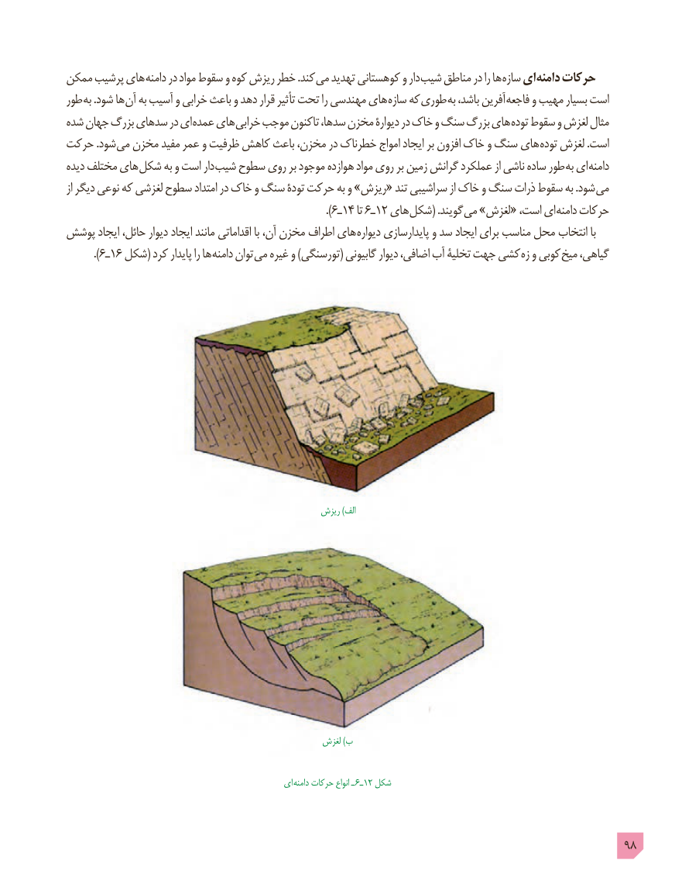

# PDF page 98

ممکن پرشیب های دامنه در مواد سقوط و کوه ریزش خطر .کند می تهدید کوهستانی و دار شیب مناطق در را ها سازه ای دامنه حرکات
طور به .شود ها آن به آسیب و خرابی باعث و دهد قرار تأثیر تحت را مهندسی های سازه که طوری به باشد، آفرین فاجعه و مهیب بسیار است
شده جهان بزرگ سدهای در ای عمده های خرابی موجب تاکنون سدها، مخزن دیوارۀ در خاک و سنگ بزرگ های توده سقوط و لغزش مثال
حرکت .شود می مخزن مفید عمر و ظرفیت کاهش باعث مخزن، در خطرناک امواج ایجاد بر افزون خاک و سنگ های توده لغزش .است
دیده مختلف های شکل به و است دار شیب سطوح روی بر موجود هوازده مواد روی بر زمین گرانش عملکرد از ناشی ساده طور به ای دامنه
از دیگر نوعی که لغزشی سطوح امتداد در خاک و سنگ تودۀ حرکت به و »ریزش« تند سراشیبی از خاک و سنگ ذرات سقوط به .شود می
                                                                                       ).6ـ14 تا 6ـ12 های شکل( .گویند می »لغزش« است، ای دامنه حرکات
پوشش ایجاد حائل، دیوار ایجاد مانند اقداماتی با آن، مخزن اطراف های دیواره پایدارسازی و سد ایجاد برای مناسب محل انتخاب با
         ).٦ـ١٦ شکل( کرد پایدار را ها دامنه توان می غیره و )تورسنگی( گابیونی دیوار اضافی، آب تخلیۀ جهت کشی زه و کوبی میخ گیاهی،

                                                     ریزش )الف

                                                       لغزش )ب

                                                 ای دامنه حرکات انواع ـ 6ـ12 شکل

                                                                                            98

