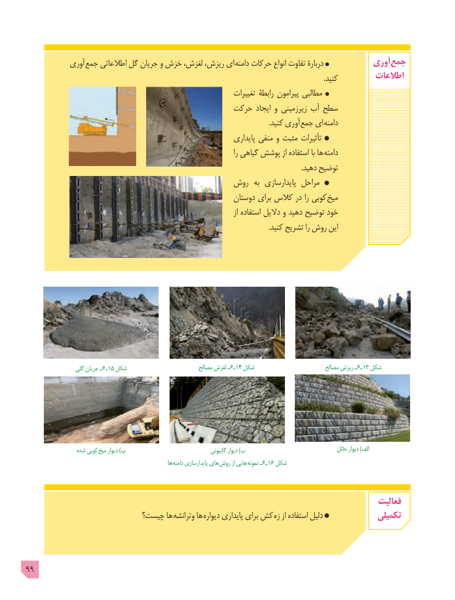

# PDF page 99

آوری جمع اطالعاتی گل جریان و خزش لغزش، ریزش، ای دامنه حرکات انواع تفاوت دربارۀ            آوری  جمع
                                                                                                                                                                        .کنید         اطالعات
                                                                   تغییرات رابطۀ پیرامون مطالبی
                                            حرکت ایجاد و زیرزمینی آب سطح
              . کنید آوری جمع ای دامنه
                                                                   پایداری منفی و مثبت تأثیرات
                                                                                              را گیاهی پوشش از استفاده با ها دامنه
                                                                                                                                                           .دهید توضیح
                                         روش  به  پایدارسازی مراحل
                                                          دوستان برای کالس در را کوبی میخ
                                                                                              از استفاده دالیل و دهید توضیح خود
                                                                                                                                         .کنید تشریح را روش این

                 گلی جریان ـ 6ـ15 شکل                          مصالح لغزش ـ 6ـ14 شکل                          مصالح ریزش ـ  6ـ13 شکل

                 شده کوبی  میخ دیوار )پ                                      گابیونی دیوار )ب                                   حائل دیوار )الف
                                                             ها دامنه پایدارسازی های  روش از هایی  نمونه ـ  6ـ16 شکل

                                                                                           فعالیت
                          چیست؟ ها وترانشه ها  دیواره پایداری برای کش زه از استفاده دلیل             تکمیلی

99

