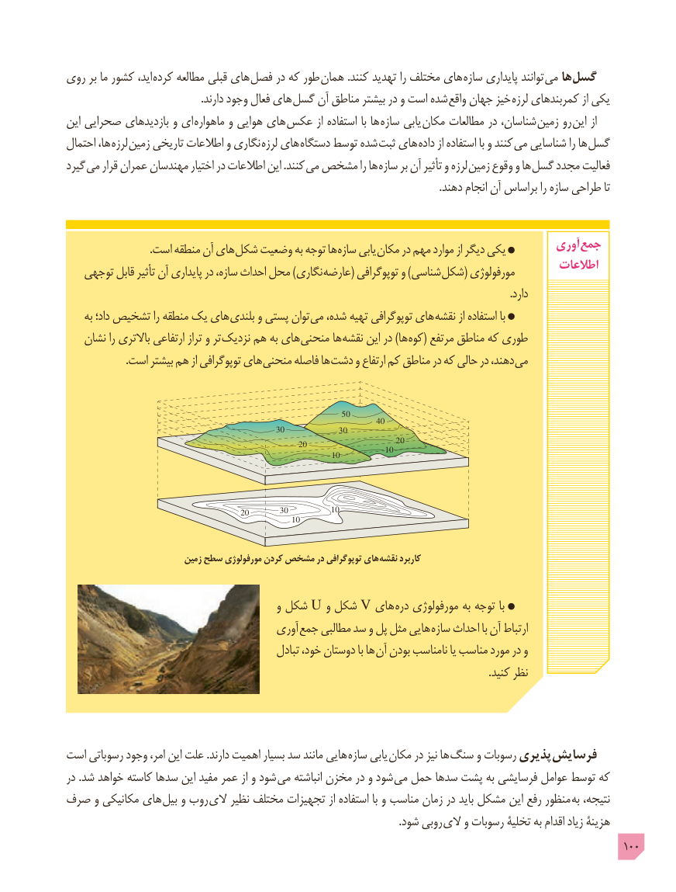

# PDF page 100

روی بر ما کشور اید، کرده مطالعه قبلی های  فصل در که طور همان .کنند تهدید را مختلف های سازه پایداری توانند می ها گسل
   . دارند وجود فعال های گسل آن مناطق بیشتر در و است شده واقع جهان خیز لرزه کمربندهای از یکی
این صحرایی بازدیدهای و ای ماهواره و هوایی های عکس از استفاده با ها سازه یابی مکان مطالعات در شناسان، زمین رو این از
احتمال ها، لرزه  زمین تاریخی اطالعات و نگاری لرزه های دستگاه توسط شده ثبت های  داده از استفاده با و کنند می شناسایی را ها گسل
گیرد می قرار عمران مهندسان اختیار در اطالعات این .کنند می مشخص را ها سازه بر آن تأثیر و لرزه زمین وقوع و ها گسل مجدد فعالیت
                                                                                                                                             .دهند انجام آن براساس را سازه طراحی تا

                                .است منطقه آن های شکل وضعیت به توجه ها سازه یابی مکان در مهم موارد از دیگر یکی         آوری جمع
   توجهی قابل تأثیر آن پایداری در سازه، احداث محل )نگاری عارضه( توپوگرافی و )شناسی شکل( مورفولوژی        اطالعات
                                                                                                                                                                        .دارد
    به داد؛ تشخیص را منطقه یک های بلندی و پستی توان می شده، تهیه توپوگرافی های نقشه از استفاده با
   نشان را باالتری ارتفاعی تراز و تر نزدیک هم به های منحنی ها نقشه این در )ها کوه( مرتفع مناطق که طوری
 . است بیشتر هم از توپوگرافی های منحنی فاصله ها دشت و ارتفاع کم مناطق در که حالی در دهند، می

                                                                50
                                                                        40
                                                 30             30
                                                                             20                                                      20                                                                          10                                                              10

                                         20       30          10
                                                    10

                           زمین سطح مورفولوژی کردن مشخص در توپوگرافی های  نقشه کاربرد

                                           و شکل U و شکل V های دره مورفولوژی به توجه با
                                      آوری جمع مطالبی سد و پل مثل هایی سازه احداث با آن ارتباط
                                              تبادل خود، دوستان با ها آن بودن نامناسب یا مناسب مورد در و
                                                                                                                                                                .کنید نظر

است رسوباتی وجود امر، این علت .دارند اهمیت بسیار سد مانند هایی سازه یابی  مکان در نیز ها سنگ و رسوبات پذیری فرسایش
در .شد خواهد کاسته سدها این مفید عمر از و شود می انباشته مخزن در و شود می حمل سدها پشت به فرسایشی عوامل توسط که
صرف و مکانیکی های  بیل و روب  الی نظیر مختلف تجهیزات از استفاده با و مناسب زمان در باید مشکل این رفع منظور به نتیجه،
              . شود روبی الی و رسوبات تخلیۀ به اقدام زیاد هزینۀ
                                                                                                 100

