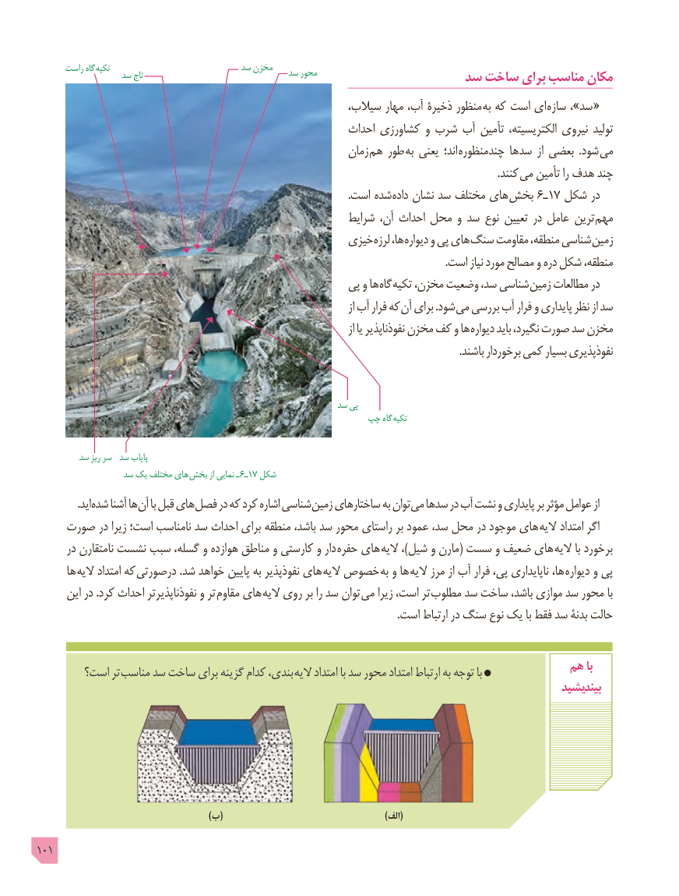

# PDF page 101

راست گاه  تکیه                           سد مخزن                 سد تاج                              سد محور                 سد ساخت برای مناسب مکان
                                                        سیالب، مهار آب، ذخیرۀ منظور به که است ای سازه ،»سد  «
                                                          احداث کشاورزی و شرب آب تأمین الکتریسیته، نیروی تولید
                                                            زمان  هم طور به یعنی اند؛ چندمنظوره سدها از بعضی  .شود می
                                     . کنند می تأمین را هدف چند
                                                                                                                      .است شده داده نشان سد مختلف های بخش 6ـ17 شکل در
                                                          شرایط آن، احداث محل و سد نوع تعیین در عامل ترین مهم
                                                 خیزی لرزه ها، دیواره و پی های سنگ مقاومت منطقه، شناسی زمین
                                                                                                                                                          .است نیاز مورد مصالح و دره شکل منطقه،
                                                    پی و ها گاه تکیه مخزن، وضعیت سد، شناسی زمین مطالعات در
                                                                                                 از آب فرار که آن برای .شود می بررسی آب فرار و پایداری نظر از سد
                                                                                                 از یا نفوذناپذیر مخزن کف و ها دیواره باید نگیرد، صورت سد مخزن
                                                                                                                                                                .باشند برخوردار کمی بسیار نفوذپذیری

                                                              سد پی
                                                    چپ گاه  تکیه

         سد ریز سر  سد پایاب
                  سد یک مختلف های  بخش از نمایی ـ  6ـ17 شکل
     . اید شده آشنا ها آن با قبل های فصل در که کرد اشاره شناسی زمین ساختارهای به توان می سدها در آب نشت و پایداری بر مؤثر عوامل از
    صورت در زیرا است؛ نامناسب سد احداث برای منطقه باشد، سد محور راستای بر عمود سد، محل در موجود های  الیه امتداد اگر
      در نامتقارن نشست سبب گسله، و هوازده مناطق و کارستی و دار  حفره های الیه ،)شیل و مارن( سست و ضعیف های  الیه با برخورد
      ها الیه امتداد که درصورتی .شد خواهد پایین به نفوذپذیر های  الیه خصوص به و ها الیه مرز از آب فرار پی، ناپایداری ها،  دیواره و پی
      این در .کرد احداث نفوذناپذیرتر و تر  مقاوم های الیه روی بر را سد توان  می زیرا است، تر مطلوب سد ساخت باشد، موازی سد محور با
                                                                                                                                        .است ارتباط در سنگ نوع یک با فقط سد بدنۀ حالت

        است؟ تر مناسب سد ساخت برای گزینه کدام بندی،  الیه امتداد با سد محور امتداد ارتباط به توجه با            هم با
                                                                                                        بیندیشید

                                                         )ب(                  )(الف
101

