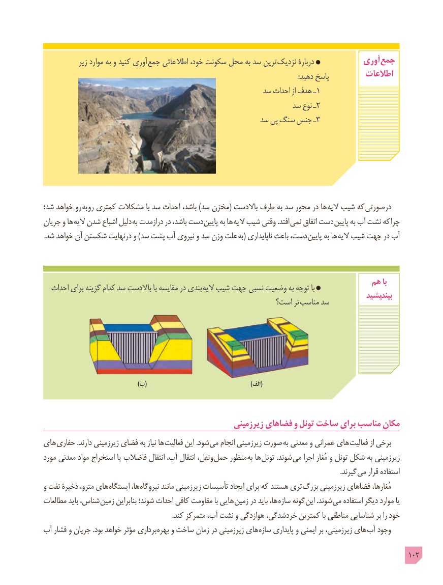

# PDF page 102

زیر موارد به و کنید آوری  جمع اطالعاتی خود، سکونت محل به سد ترین نزدیک دربارۀ            آوری جمع
                                                                                                                                                   :دهید پاسخ         اطالعات
                                                   سد احداث از هدف ـ 1
                                                          سد نوع ـ 2
                                                  سد پی سنگ جنس ـ3

شد؛ خواهد رو به رو کمتری مشکالت با سد احداث باشد، )سد مخزن( باالدست طرف به سد محور در ها الیه شیب که درصورتی
جریان و ها الیه شدن اشباع دلیل به درازمدت در باشد، دست پایین به ها الیه شیب وقتی .افتد  نمی اتفاق دست پایین به آب نشت که  چرا
.شد خواهد آن شکستن درنهایت و )سد پشت آب نیروی و سد وزن علت  به( ناپایداری باعث دست، پایین به ها الیه شیب جهت در آب

                                                                        هم با  احداث برای گزینه کدام سد باالدست با مقایسه در بندی  الیه شیب جهت نسبی وضعیت به توجه با
                                                                                                  بیندیشید                                                         است؟ تر مناسب سد

                                                )ب(                 )(الف

                                                   زیرزمینی فضاهای و تونل ساخت برای مناسب مکان
های حفاری .دارند زیرزمینی فضای به نیاز ها  فعالیت این .شود می انجام زیرزمینی صورت  به معدنی و عمرانی های  فعالیت از برخی
مورد معدنی مواد استخراج یا فاضالب انتقال آب، انتقال نقل، و حمل منظور به ها تونل .شوند می اجرا مُغار و تونل شکل به زیرزمینی
                               . گیرند می قرار استفاده
و نفت ذخیرۀ مترو، های  ایستگاه ها، نیروگاه مانند زیرزمینی تأسیسات ایجاد برای که هستند تری  بزرگ زیرزمینی فضاهای مُغارها،
مطالعات باید شناس، زمین بنابراین شوند؛ احداث کافی مقاومت با هایی زمین در باید ها، سازه گونه این .شوند می استفاده دیگر موارد یا
                                                                          .کند متمرکز آب، نشت و هوازدگی خردشدگی، کمترین با مناطقی شناسایی بر را خود
آب فشار و جریان .بود خواهد مؤثر داری بر بهره و ساخت زمان در زیرزمینی های سازه پایداری و ایمنی بر زیرزمینی، های آب وجود

                                                                                                 102

