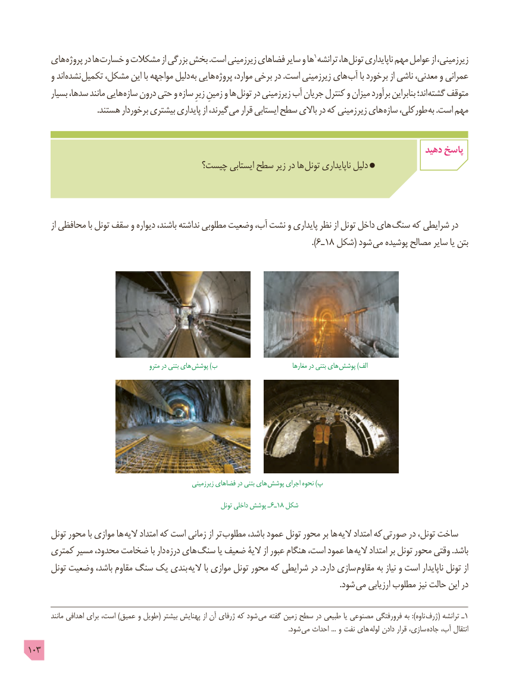

# PDF page 103

های پروژه در ها خسارت و مشکالت از بزرگی بخش .است زیرزمینی فضاهای سایر و ها 1 ترانشه ها، تونل ناپایداری مهم عوامل از زیرزمینی،
      و اند نشده تکمیل مشکل، این با مواجهه دلیل به هایی پروژه موارد، برخی در .است زیرزمینی های آب با برخورد از ناشی معدنی، و عمرانی
       بسیار سدها، مانند هایی سازه درون حتی و سازه زیرِ زمینِ و ها تونل در زیرزمینی آب جریان کنترل و میزان برآورد بنابراین اند؛ گشته متوقف
 . هستند برخوردار بیشتری پایداری از گیرند، می قرار ایستابی سطح باالی در که زمینی زیر های سازه طورکلی، به .است مهم

                                                                                              دهید پاسخ
                                  چیست؟ ایستابی سطح زیر در ها تونل ناپایداری دلیل

         از محافظی با تونل سقف و دیواره باشند، نداشته مطلوبی وضعیت آب، نشت و پایداری نظر از تونل داخل های سنگ که شرایطی در
                                                                                         ).6ـ18 شکل( شود می پوشیده مصالح سایر یا بتن

                                              مترو در بتنی های پوشش )ب                              مغارها در بتنی های  پوشش )الف

                                                            زیرزمینی فضاهای در بتنی های  پوشش اجرای نحوه )پ
                                                                    تونل داخلی پوشش ـ 6ـ18 شکل

      تونل محور با موازی ها الیه امتداد که است زمانی از تر  مطلوب باشد، عمود تونل محور بر ها الیه امتداد که  صورتی در تونل، ساخت
     کمتری مسیر محدود، ضخامت با دار درزه های  سنگ یا ضعیف الیۀ از عبور هنگام است، عمود ها الیه امتداد بر تونل محور وقتی .باشد
      تونل وضعیت باشد، مقاوم سنگ یک بندی  الیه با موازی تونل محور که شرایطی در .دارد سازی  مقاوم به نیاز و است ناپایدار تونل از
                                  . شود می ارزیابی مطلوب نیز حالت این در

         مانند اهدافی برای است، )عمیق و طویل( بیشتر پهنایش از آن ژرفای که شود می گفته زمین سطح در طبیعی یا مصنوعی فرورفتگی به ):ناوه  ژرف١( ترانشه ـ
                                                                                                                                                              .شود می احداث ... و نفت های لوله دادن قرار سازی،  جاده آب، انتقال
103

