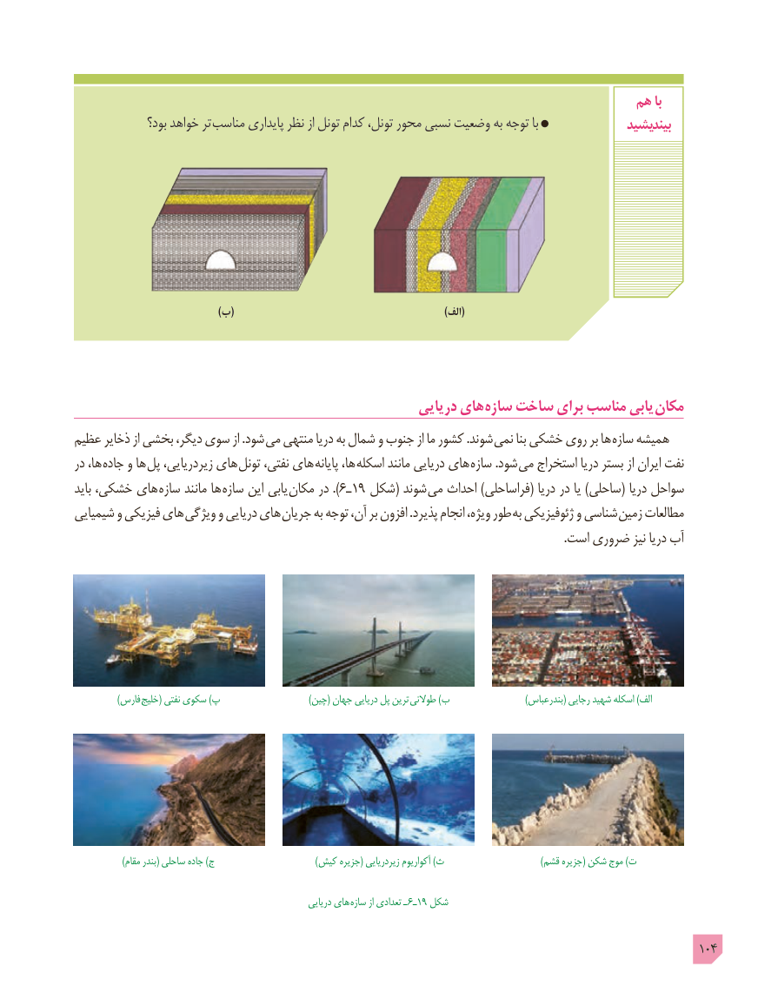

# PDF page 104

هم با
               بود؟ خواهد تر  مناسب پایداری نظر از تونل کدام تونل، محور نسبی وضعیت به توجه با                بیندیشید

                                          )ب(                     )(الف

                                                      دریایی های سازه ساخت برای مناسب یابی  مکان
عظیم ذخایر از بخشی دیگر، سوی از .شود می منتهی دریا به شمال و جنوب از ما کشور .شوند  نمی بنا خشکی روی بر ها  سازه همیشه
در ها، جاده و ها  پل زیردریایی، های  تونل نفتی، های پایانه ها، اسکله مانند دریایی های  سازه .شود می استخراج دریا بستر از ایران نفت
باید خشکی، های سازه مانند ها سازه این یابی  ).مکان در  6ـ19 شکل( شوند  می احداث )فراساحلی( دریا در یا )ساحلی( دریا سواحل
شیمیایی و فیزیکی های ویژگی و دریایی های  جریان به توجه آن، بر افزون .پذیرد انجام ویژه، طور به ژئوفیزیکی و شناسی زمین مطالعات
                                                                                                                                                                      .است ضروری نیز دریا آب

   ) فارس خلیج( نفتی سکوی )پ  ) چین( جهان دریایی پل ترین طوالنی )ب                          )بندرعباس( رجایی شهید اسکله )الف

                 )مقام بندر( ساحلی جاده )ج                                   )کیش جزیره( زیردریایی آکواریوم )ث                                 )قشم جزیره( شکن موج )ت

                                                            دریایی های  سازه از تعدادی ـ  6ـ19 شکل

                                                                                                 104

