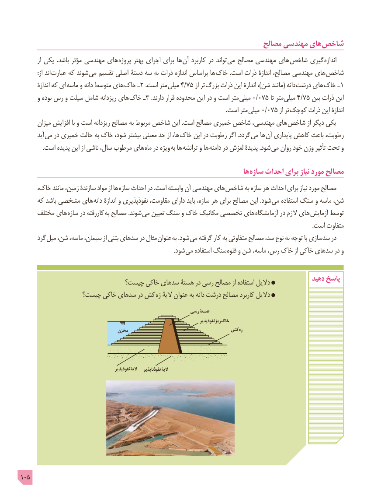

# PDF page 105

مصالح مهندسی های شاخص
         از یکی  .باشد مؤثر مهندسی های پروژه بهتر اجرای برای ها آن کاربرد در تواند می مصالح مهندسی های شاخص گیری اندازه
           :از اند  عبارت که شوند می تقسیم اصلی دستۀ سه به ذرات اندازه براساس ها خاک .است ذرات اندازۀ مصالح، مهندسی های شاخص
        اندازۀ که ای ماسه و دانه متوسط های خاک ـ2 .است متر میلی 4/75 از تر بزرگ ذرات این اندازۀ ،)شن مانند( دانه درشت های خاک ـ1
      و بوده رس و سیلت شامل ریزدانه های خاک ـ3 .دارند قرار محدوده این در و است متر میلی 0/075 تا متر  میلی 4/75 بین ذرات این
                 . است متر میلی 0/075 از تر  کوچک ذرات این اندازۀ
      میزان افزایش با و است ریزدانه مصالح به مربوط شاخص این .است مصالح خمیری شاخص مهندسی، های شاخص از دیگر یکی
       آید  می در خمیری حالت به خاک شود، بیشتر معینی حد از ها، خاک این در رطوبت اگر .گردد می ها آن پایداری کاهش باعث رطوبت،
. است پدیده این از ناشی سال، مرطوب های ماه در ویژه به ها ترانشه و ها دامنه در لغزش پدیدۀ .شود می روان خود وزن تأثیر تحت و

                                                                          ها سازه احداث برای نیاز مورد مصالح
     خاک، مانند زمین، سازندۀ مواد از ها سازه احداث در .است وابسته آن مهندسی های شاخص به سازه هر احداث برای نیاز مورد مصالح
     که باشد مشخصی های دانه اندازۀ و نفوذپذیری مقاومت، دارای باید سازه، هر برای مصالح این .شود می استفاده سنگ و ماسه شن،
     مختلف های سازه در کاررفته  به مصالح .شوند  می تعیین سنگ و خاک مکانیک تخصصی های آزمایشگاه در الزم های آزمایش توسط
                                                                                                                                                                                                    .است متفاوت
      گرد میل شن، ماسه، سیمان، از بتنی سدهای در مثال  عنوان به .شود می گرفته کار به متفاوتی مصالح سد، نوع به توجه با سدسازی در
                       . شود می استفاده سنگ قلوه و شن ماسه، رس، خاک از خاکی سدهای در و

                            چیست؟ خاکی سدهای هستۀ در رسی مصالح از استفاده دالیل             دهید پاسخ
                چیست؟ خاکی سدهای در کش زه الیۀ عنوان به دانه درشت مصالح کاربرد دالیل

                                                          رسی هستۀ
                                                                                                نفوذپذیر ریز خاک
                                    مخزن                          کش زه

                                                  نفوذپذیر الیۀ   نفوذناپذیر الیۀ

105

