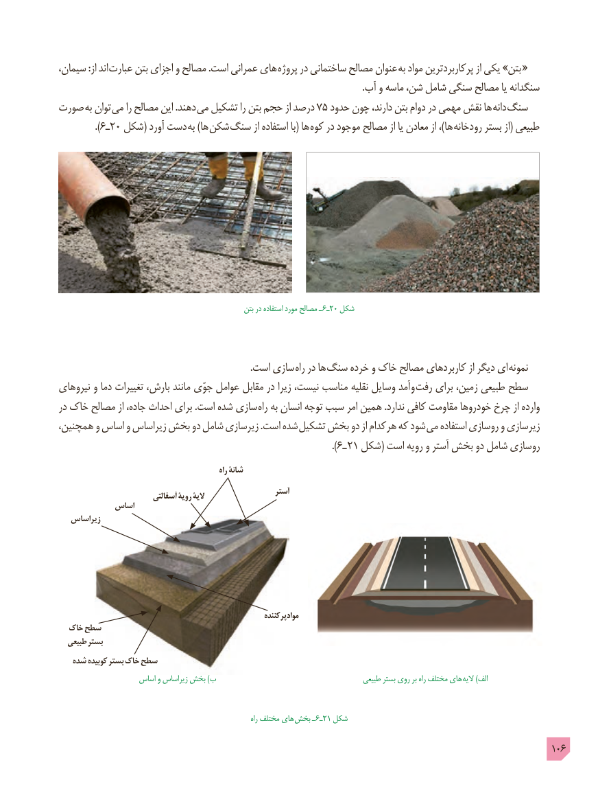

# PDF page 106

سیمان، :از اند عبارت بتن اجزای و مصالح .است عمرانی های پروژه در ساختمانی مصالح عنوان به مواد پرکاربردترین از یکی »بتن  «
                                                                                                                                  .آب و ماسه شن، شامل سنگی مصالح یا سنگدانه
صورت به توان می را مصالح این .دهند می تشکیل را بتن حجم از درصد 75 حدود چون دارند، بتن دوام در مهمی نقش ها  دانه سنگ
          ).6ـ20 شکل( آورد دست به )ها شکن سنگ از استفاده با( ها  کوه در موجود مصالح از یا معادن از ،)ها رودخانه بستر از( طبیعی

                                                        بتن در استفاده مورد مصالح ـ 6ـ20 شکل

        . است سازی راه در ها سنگ خرده و خاک مصالح کاربردهای از دیگر ای  نمونه
نیروهای و دما تغییرات بارش، مانند جوّی عوامل مقابل در زیرا نیست، مناسب نقلیه وسایل وآمد  رفت برای زمین، طبیعی سطح
در خاک مصالح از جاده، احداث برای .است شده سازی راه به انسان توجه سبب امر همین .ندارد کافی مقاومت خودروها چرخ از وارده
همچنین، و اساس و زیراساس بخش دو شامل زیرسازی .است شده  تشکیل بخش دو از هرکدام که شود می استفاده روسازی و زیرسازی
                                                                           ).6ـ 21 شکل( است رویه و آستر بخش دو شامل روسازی
                                                         راه شانۀ
                                                            آستر                           آسفالتی رویۀ الیۀ
           اساس
   زیراساس

                                                                 موادپرکننده
  خاک سطح
  طبیعی بستر
   شده کوبیده بستر خاک سطح
                   اساس و زیراساس بخش )ب                                         طبیعی بستر روی بر راه مختلف های  الیه )الف

                                                                               راه مختلف های بخش ـ 6ـ21 شکل
                                                                                                 106

